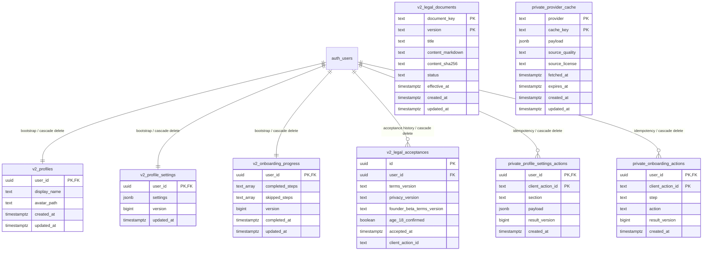

# V2 Physical ERD & Security Matrix — Auth, Profile, Settings and Legal Foundation

**Status:** Live-verified foundation slice; not the physical schema for future Training/Coach/Nutrition domains  
**Repository:** `allinproject/All-In-V2`  
**Branch:** `integration/v2-foundation`  
**Branch head at initial physical audit:** `cf6b241db39af5400ce1854d14185a520d4aa997`  \n**Refreshed against branch head:** `820936636cfc48ddfd26a995aabe332882be60b4` (2026-11-10; includes migration 006 and provider-cache cleanup verification).
**Generated public database types:** `apps/mobile-v2/src/types/database.types.ts` (generated from live schema on 2026-11-10; includes five public tables and six public RPCs; private schema intentionally excluded).  
**Supabase project:** `xarhuczrtzuiljmtdaeu` (All-In-V2)  
**Verification date:** 2026-11-10  
**Linear owner:** ALL-222; security evidence ALL-223

> This document records only the eight foundation tables and their deployed policies, grants, functions and relationships. It is not authorization to create dependent domain tables. Planned domains remain governed by the ownership matrix and require their own reviewed schema slices.

## 1. Applied migration sequence

The source filenames and Supabase migration history use different timestamps. The mapping below is from the live `supabase_migrations.schema_migrations` state and the exact source files on the V2 branch.

| Source file | Applied database version | Purpose |
|---|---:|---|
| `20261110000100_v2_auth_profile_legal_foundation.sql` | `20261110021548` | Auth bootstrap, Profile, Settings, Onboarding, Legal Documents/Acceptances, settings idempotency ledger, initial RLS/grants/RPCs. |
| `20261110000200_v2_tighten_profile_privileges_and_legal_versions.sql` | `20261110022457` | Column-limited Profile updates, updated-at triggers, immutable published legal content and current-version acceptance checks. |
| `20261110000300_v2_provider_cache_and_private_rls.sql` | `20261110032039` | RLS defense-in-depth on private operational ledger, server-only provider cache and service-role cache RPCs. |
| `20261110000400_v2_onboarding_progress_writer.sql` | `20261110101200` | Private onboarding action ledger and authenticated owner-only step writer with complete/skip/reset, expected-version and idempotent retry semantics. |
| `20261110000500_v2_expected_owner_mutation_guards.sql` | `20261110105423` | Replaces the three authenticated mutation RPC signatures with expected-owner UUIDs checked against `auth.uid()` inside PostgreSQL. |
| `20261110000600_v2_provider_cache_expired_cleanup.sql` | `20261110122952` | Adds a bounded service-role-only RPC to delete expired provider-cache rows without direct cache-table grants. |

No V1 migration or object is part of this schema.

## 2. Physical ERD — deployed objects only

Notes:
- `auth.users` is Supabase Auth's identity table and is not a V2-owned table.
- `v2_legal_documents` has a composite primary key `(document_key, version)`. Legal acceptance stores exact version strings and checks them against the latest published versions in the canonical acceptance RPC; there are intentionally no direct FKs because each receipt requires three fixed document keys.
- `v2_profile_settings_actions` has composite primary key `(user_id, client_action_id)`, ensuring one idempotency record per actor/action.
- `v2_onboarding_actions` has composite primary key `(user_id, client_action_id)` and foreign key to `auth.users`; each record stores allowlisted step/action and resulting onboarding version for exact retry replay.
- `v2_provider_cache` has composite primary key `(provider, cache_key)`; it is independent of user identity and stores only bounded provider response cache data.
- All eight tables currently have zero rows. No legal documents are published and no legal acceptance records exist.

## 3. Deployed table contract and security matrix

| Physical table | Owner / class | RLS and policy | API grants | Canonical mutation path / current limitation |
|---|---|---|---|---|
| `public.v2_profiles` | Auth/Profile; user-private | RLS enabled. SELECT own row. UPDATE own row with identical USING/WITH CHECK owner test. | Authenticated SELECT; UPDATE only `display_name`, `avatar_path`. No anon access, INSERT, DELETE or whole-table UPDATE. | Auth trigger creates the row. User edits only the two approved columns. `updated_at` trigger owns timestamp. |
| `public.v2_profile_settings` | Profile settings; user-private | RLS enabled. SELECT own row only. | Authenticated SELECT only. No direct authenticated writes. | `v2_patch_profile_settings_section(expected_user_id, section, patch, expected_version, action_id)` is the canonical write RPC; checks expected owner equals `auth.uid()`, validates allowlisted section/object patch/action ID/expected version, serializes per-user writes, returns exact retry outcome and writes private idempotency ledger. |
| `public.v2_onboarding_progress` | Profile onboarding; user-private | RLS enabled. SELECT own row only. | Authenticated SELECT only. No direct authenticated writes. | Auth trigger initializes one empty row. `v2_set_onboarding_step(expected_user_id, step, action, expected_version, action_id)` is the canonical authenticated writer; checks expected owner equals `auth.uid()`, supports complete/skip/reset, per-user serialization, expected-version checks, exact retry replay and private idempotency ledger. No direct authenticated table writes. |
| `public.v2_legal_documents` | Legal operations; published product content | RLS enabled. SELECT only rows with `status='published'` and `effective_at <= now()`. | anon/authenticated SELECT only. No client writes. | Reviewed operator/migration publication workflow. Published content fields are immutable; insert a new version instead of editing published content. No documents are currently published. |
| `public.v2_legal_acceptances` | Legal/account lifecycle; user-private immutable receipt | RLS enabled. SELECT own rows only. | Authenticated SELECT only. No direct INSERT/UPDATE/DELETE. | `v2_accept_legal_documents(expected_user_id, terms, privacy, founder_terms, age_confirmed, action_id)` checks expected owner equals `auth.uid()`, age attestation, exact latest published versions and actor; per-user client action is unique and idempotent. |
| `allin_private.v2_profile_settings_actions` | Profile settings infrastructure; private operational metadata | RLS enabled, deliberately no policies. | No schema USAGE or direct table privilege for anon/authenticated/service_role. Owner `postgres` retains migration/function-owner privileges. | Only reached from `v2_patch_profile_settings_section` SECURITY DEFINER path. Never add permissive policies to silence no-policy INFO. |
| `allin_private.v2_onboarding_actions` | Onboarding infrastructure; private per-user idempotency metadata | RLS enabled, deliberately no policies. | No schema USAGE or direct table privilege for anon/authenticated/service_role. | Only reached from `v2_set_onboarding_step` SECURITY DEFINER path. |
| `allin_private.v2_provider_cache` | Provider infrastructure; private operational cache | RLS enabled, deliberately no policies. | No schema USAGE or direct table privilege for anon/authenticated/service_role. | Only service-role-only `v2_provider_cache_get/put/prune_expired` SECURITY DEFINER RPCs. Not canonical ingredient/nutrition truth. |

### Verified table constraints and indexes

- All five public foundation tables and all three private tables have RLS enabled.
- Profile, Settings and Onboarding each have one row per Auth user via a primary key on `user_id` and cascading FK to `auth.users(id)`.
- Onboarding has a finite six-step allowlist (`focus`, `training_pattern`, `availability`, `coach`, `food_safety`, `proactivity`); completed and skipped arrays cannot overlap.
- Settings requires a JSON object and positive version.
- Published Legal Documents require an effective timestamp; document key is restricted to Terms, Privacy and Founder Beta Terms.
- Legal Acceptances require `age_18_confirmed=true`, nonempty bounded action ID and unique `(user_id, client_action_id)`.
- Onboarding action ledger restricts step to the canonical six-step allowlist, action to `complete`/`skip`/`reset`, and result version to a positive value.
- Provider cache restricts provider namespace, cache key, JSON object/array payload, payload to 512 KiB, expiry after fetch, fetch time no more than one day in the future and TTL no longer than 30 days.
- Indexes: published legal lookup by `(document_key, effective_at DESC)` partial on published; legal acceptance history by `(user_id, accepted_at DESC)`; composite primary-key indexes for settings/onboarding idempotency ledgers; provider-cache expiry by `expires_at`.

## 4. Deployed function and trigger matrix

All listed functions are owned by `postgres` and have an empty function search path (`search_path=''`) in the live catalog.

| Function | SECURITY DEFINER | EXECUTE grants | Contract |
|---|---:|---|---|
| `public.v2_handle_new_user()` | Yes | No anon/authenticated/service_role direct EXECUTE | Auth.users AFTER INSERT trigger creates Profile, Settings and Onboarding rows. Not a client API. |
| `public.v2_my_profile_state()` | Yes | authenticated only | Requires `auth.uid()`; returns only the caller's Profile, Settings, Onboarding, current published legal documents and latest acceptance. |
| `public.v2_patch_profile_settings_section(uuid,text,jsonb,bigint,text)` | Yes | authenticated only | Requires `p_expected_user_id = auth.uid()` and fails SQLSTATE 42501 on mismatch; per-user advisory transaction lock; allowlisted sections; nonempty JSON object; positive expected version; bounded action ID; exact retry returns original version; changed-payload action-ID reuse fails; stale version raises serialization conflict. |
| `public.v2_set_onboarding_step(uuid,text,text,bigint,text)` | Yes | authenticated only | Requires `p_expected_user_id = auth.uid()` and fails SQLSTATE 42501 on mismatch; one allowlisted step per call; complete/skip/reset; advisory lock; expected-version guard; same-state no-op without version bump; exact retries return original version even after later changes; changed action-ID reuse fails.
| `public.v2_accept_legal_documents(uuid,text,text,text,boolean,text)` | Yes | authenticated only | Requires `p_expected_user_id = auth.uid()` and fails SQLSTATE 42501 on mismatch; exact latest current published Terms/Privacy/Founder Beta Terms; age attestation; bounded per-user idempotency key; changed-payload reuse fails. |
| `public.v2_provider_cache_get(text,text)` | Yes | service_role only | Explicitly checks `auth.role()='service_role'`; returns unexpired cache plus source/license/freshness metadata. |
| `public.v2_provider_cache_put(text,text,jsonb,text,text,timestamptz,timestamptz)` | Yes | service_role only | Explicitly checks service role; provider allowlist, key, payload size/type and fetch/expiry bounds; upsert by provider/cache key. |
| `public.v2_provider_cache_prune_expired(integer)` | Yes | service_role only | Explicitly checks service role; batch 1–5,000; deletes only expired rows in expiry order with `FOR UPDATE SKIP LOCKED`; no direct table grant or automatic scheduler. |
| `public.v2_set_updated_at()` | No | No API EXECUTE | Trigger helper for Profile, Settings and Onboarding timestamps. |
| `public.v2_prevent_published_legal_content_change()` | No | No API EXECUTE | Trigger rejects changes to published document key/version/title/content/hash/effective timestamp. |

Trigger map:
- `auth.users` AFTER INSERT → `v2_handle_new_user`.
- `v2_profiles`, `v2_profile_settings`, `v2_onboarding_progress` BEFORE UPDATE → `v2_set_updated_at`.
- `v2_legal_documents` BEFORE UPDATE → `v2_prevent_published_legal_content_change`.

## 5. Live privilege and RLS evidence

Verified against the live project catalog on 2026-11-10:

- `allin_private` schema: `anon` USAGE=false; `authenticated` USAGE=false; `service_role` USAGE=true.
- All three private tables: `anon`, `authenticated` and `service_role` have no direct table SELECT/INSERT/UPDATE grants. There are no policies by design. The private tables are RLS-enabled.
- Public Profile/Settings/Onboarding/Legal policies match the matrix above. `anon` has only Legal Documents SELECT; authenticated users have owner reads and the two-column Profile UPDATE grant.
- `authenticated` can update `display_name` and `avatar_path`; cannot update `user_id`, `created_at` or `updated_at`. Whole-table UPDATE privilege is false.
- Authenticated users cannot directly INSERT into Settings, Onboarding or Legal Acceptances. No anonymous direct reads exist for private user rows.
- The public API functions with authenticated EXECUTE are the four per-user RPCs listed above. Provider cache RPCs are service_role-only. Trigger helpers have no API EXECUTE grant.
- `v2_provider_cache_prune_expired(integer)` is postgres-owned SECURITY DEFINER, empty search_path, anon/authenticated EXECUTE=false, service_role EXECUTE=true. A rollback-only live fixture passed; no recurring cleanup job is installed because no approved scheduler/cron extension is present.
- Supabase security advisor's three private-table `rls_enabled_no_policy` INFO notices are intentional. Its four authenticated SECURITY DEFINER RPC WARN notices are documented; each per-user RPC checks actor identity and scopes reads/writes to that identity. Do not grant authenticated direct private-schema access or add permissive policies to silence the advisor.
- All eight tables have zero rows. The onboarding writer was replay-tested with two synthetic authenticated users; those users, their progress rows and action-ledger records were rolled back. This is a structural/security verification, not proof of real user signup, published legal-document acceptance or installed-client lifecycle.

## 6. Outstanding foundation decisions / explicit gaps

1. **Onboarding UI acceptance:** `app/onboarding-required.tsx` now contains the progressive six-step wizard and uses `v2_set_onboarding_step` plus the existing versioned Profile Settings writer. It checks current session ownership before writes, refreshes authoritative state, supports resume/back/skip/retry and leaves skipped values unknown. Remaining: full app typecheck, mounted/client tests, real signed-in flow and installed-device/session-change acceptance.
2. **Legal publication:** define a reviewed operator publication/revision process and audit evidence. Do not publish draft text or allow client writes. Current foundation intentionally has no published legal documents.
3. **Profile avatar storage:** `avatar_path` is only a text reference. Storage bucket, object path ownership, MIME/size limits, signed URL/read behavior, replacement and deletion semantics require a separate approved storage contract before avatar upload UI.
4. **Default privileges:** migrations revoke default privileges for future objects created by the `postgres` migration role in `public`. The Supabase-managed `supabase_admin` defaults are separate; every new migration must continue explicit per-object grants/revokes/RLS and must not assume default ACLs alone secure an object.
5. **Account deletion:** Auth cascade currently deletes Profile, Settings, Onboarding, Legal Acceptance and private settings-action records. Retention/legal obligations and provider/cache cleanup are not fully resolved by this foundation. The shared ALL-251 lifecycle contract must specify the complete product deletion/export behavior before release.
6. **Clean rebuild / app validation:** live database types are now generated and checked in at `apps/mobile-v2/src/types/database.types.ts`, and the mobile Supabase client is parameterized with `Database`. Clean project reset/replay, npm install, typecheck, test suites and reproducible app bundle remain in ALL-224/ALL-222.

No future domain table should be added until its owner supplies the same physical record: columns/types/nullability/defaults/checks/PK/FKs/indexes, classification, grants, RLS policies, writer/read RPCs, idempotency/version contract, function owner/search path/EXECUTE and authenticated two-user negative tests.

## 7. Expected-owner mutation guard — migration 005

Applied migration:
- Source: `supabase/migrations/20261110000500_v2_expected_owner_mutation_guards.sql`
- Live database version: `20261110105423` (`v2_expected_owner_mutation_guards`).

All three authenticated mutation RPCs now require the caller's captured expected account UUID as the first argument. The function compares it to `auth.uid()` inside the SECURITY DEFINER body before performing any read/write or checking action-ledger replay. A mismatch or null expected identity fails with SQLSTATE `42501`.

| RPC | Current argument contract |
|---|---|
| `v2_patch_profile_settings_section(uuid,text,jsonb,bigint,text)` | expected user, settings section, patch, expected settings version, action ID |
| `v2_accept_legal_documents(uuid,text,text,text,boolean,text)` | expected user, Terms version, Privacy version, Founder Beta Terms version, age attestation, action ID |
| `v2_set_onboarding_step(uuid,text,text,bigint,text)` | expected user, step, complete/skip/reset action, expected onboarding version, action ID |

The previous signatures were dropped; no unbound overload remains. Authenticated-only EXECUTE grants were applied to the new signatures. Function ownership remains postgres, SECURITY DEFINER remains enabled, search path remains empty, and existing idempotency/version guards are unchanged.

Committed rollback-only regression fixtures:
- `supabase/tests/v2_expected_owner_mutation_guard.sql`: all three RPCs reject Account B as expected owner while Account A's JWT is active; then checks Account A's correct Settings owner passes the identity boundary. Switches JWT to Account B and verifies Account A is rejected.
- `supabase/tests/v2_onboarding_progress_writer_replay.sql`: the complete onboarding lifecycle/retry/isolation replay now passes the explicit expected owner.

Both fixtures executed against V2 without SQL errors. The synthetic accounts, progress/settings rows, legal receipts and both action ledgers were verified at zero after rollback. Live signature/grant inspection confirms only the new argument signatures exist; anon/service_role cannot execute them, authenticated can. The three private-table INFO and four per-user SECURITY DEFINER WARN advisor findings remain the expected documented posture.
