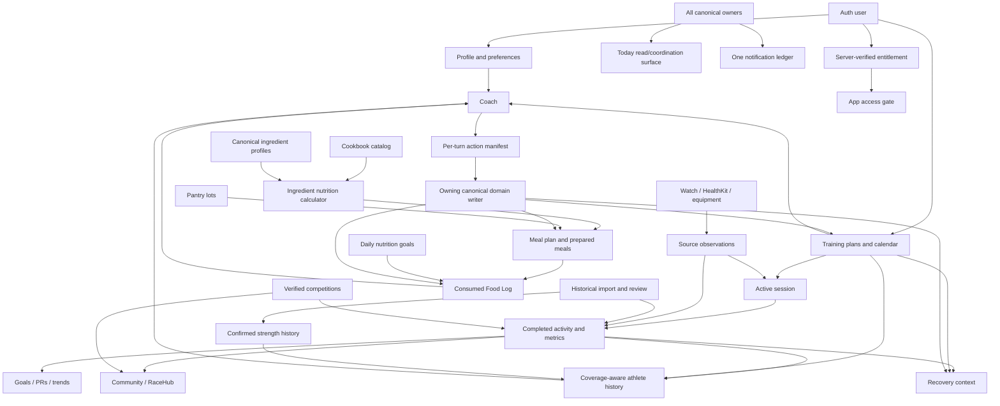

# ALL IN 365 V2 — Domain Ownership, Security & Event Contracts

**Status:** Working architecture matrix; schema/write decisions remain subject to ALL-222 review  
**Repository:** `allinproject/All-In-V2`  
**Branch at authoring:** `integration/v2-foundation`  
**Reference head at initial architecture write:** `768f2e99c1dec922d46955f982db836e78ea26d6`  
**Canonical backend:** Supabase project `xarhuczrtzuiljmtdaeu` (`All-In-V2`)  
**Project tracking:** Linear `ALL IN 365 — V2 Rebuild`  
**Last reconciled:** 2026-11-10

> This is an ownership and security contract, not a claim that the listed workspaces or tables have already been implemented. Only the explicitly listed foundation tables/functions currently exist. All future schemas require a separate migration, focused tests and domain-owner approval.

## 1. Binding product and architecture decisions

1. V2 is an independent application and backend. V2 Supabase is canonical from the first V2 account onward. V1 is read-only reference material for approved behavior, product data and lessons.
2. Create a fresh V2 account. Do not migrate V1 credentials, the single founder/test Coach thread, or personal V1 database rows by default. Optional user-authorized historical source import is a separate product capability (ALL-256/257), not account migration.
3. One canonical owner and one canonical writer per business action. Screens, Coach, Today and integrations are clients/readers of that owner, not parallel stores.
4. Coach may read, explain, navigate and propose. It never receives generic database mutation authority. Apply goes through an action manifest, explicit user intent and the owning domain writer.
5. RLS is enabled by default on exposed user/private data. Least-privilege grants are explicit. Private schemas are not API-exposed. No permissive policy is added merely to silence an advisor notice.
6. Distinguish catalog/product data, user-owned data, provider observations, imported data, derived values and model suggestions.
7. Missing/partial data is never coerced to zero. Preserve source, capture time, retrieval time, unit, preparation state, quality/coverage and derivation/version where applicable.
8. Planned workouts, active sessions and completed activities are distinct identities with explicit links. Device observations do not themselves become canonical workouts until validated by the owning flow.
9. Mutations are small, traceable and independently testable. A feature is not complete from source presence or mocked tests alone.
10. Approved App Art v2 and the five root tabs (Today / Fuel / Train / Community / Coach) remain closed product authority. Profile remains avatar/header accessed.

## 2. Current V2 backend and source — verified snapshot

### Applied V2 migrations

| Applied database version | Migration source | Current effect |
|---|---|---|
| `20261110021548` | `20261110000100_v2_auth_profile_legal_foundation.sql` | Auth-linked Profile, Settings, Onboarding, Legal Documents, Legal Acceptances and private profile-settings action ledger; owner read policies and canonical RPCs. |
| `20261110022457` | `20261110000200_v2_tighten_profile_privileges_and_legal_versions.sql` | Profile column-level update privilege, immutable published legal content, updated-at triggers and hardened legal/profile RPC behavior. |
| `20261110032039` | `20261110000300_v2_provider_cache_and_private_rls.sql` | RLS enabled on both private tables; provider cache and service-role-only cache RPCs. |

### Current tables

| Table | Canonical owner | Classification | Direct client access | Mutation boundary |
|---|---|---|---|---|
| `public.v2_profiles` | Auth/Profile | User-private | Authenticated owner SELECT; only `display_name` and `avatar_path` UPDATE columns | Auth trigger creates row; column-limited direct update as currently approved. |
| `public.v2_profile_settings` | Auth/Profile settings | User-private | Authenticated owner SELECT only | `v2_patch_profile_settings_section`, with authenticated identity, allowlisted section, action ID and expected version. |
| `public.v2_onboarding_progress` | Auth/Profile onboarding | User-private | Authenticated owner SELECT only | Server-owned/versioned writer; direct client mutation not granted. |
| `public.v2_legal_documents` | Legal/Product operations | Product-published content | SELECT published/effective versions to anon/authenticated | Reviewed operator/server publication process; published content is immutable. |
| `public.v2_legal_acceptances` | Legal/Account lifecycle | User-private, immutable receipt | Authenticated owner SELECT only | `v2_accept_legal_documents` validates exact current published versions and owner. |
| `allin_private.v2_profile_settings_actions` | Auth/Profile settings idempotency | Private operational metadata | No anon/authenticated schema usage or table grants; RLS enabled; no policies by design | Only the owning settings RPC accesses it. |
| `allin_private.v2_provider_cache` | Provider infrastructure | Private cached external reference responses | No anon/authenticated/service-role table grants; RLS enabled; no policies by design | Service-role-only `v2_provider_cache_get/put` RPCs. Cache is not canonical reviewed ingredient truth. |

The V2 project currently has zero user rows in the verified Profile/Legal/Provider tables. No legal documents are published, so real signup remains intentionally gated.

### Current mobile source

The current V2 tree has an Expo Router/Auth shell plus pure feature-owned Cookbook and Training modules. The Cookbook calculator/provider-independent arithmetic and Training plan/history/race-course/prediction contracts are source slices; live backend readers, canonical persistence and full UI/device wiring remain separate acceptance work.

## 3. Canonical domain ownership matrix

Every domain must have exactly one canonical owner for its records and lifecycle. Issue IDs below are implementation owners, not evidence of completion.

| Domain / aggregate | Canonical owner | Owns | Must not own / duplicate | Primary consumers |
|---|---|---|---|---|
| Auth, Profile, account identity | ALL-216 / ALL-209; lifecycle extension ALL-251 | V2 identity, profile, session lifecycle, user settings, onboarding and account recovery | V1 identity/passwords; duplicated preference stores | All authenticated domains |
| Legal acceptance | ALL-216 / ALL-209; ALL-251 | Published legal versions, immutable user/version acceptance receipts and acceptance gate | Mutable acceptance receipts; legal copy embedded as app-only truth | Signup, Profile, billing and app access gate |
| Coach conversation/runtime | ALL-217 | Threads/messages, bounded settled context, task routing, provider/cost controls and model response provenance | Shadow copies of workouts, Food Log, goals, preferences or other canonical domain facts | Today and all user-facing workspaces |
| Coach safe actions | ALL-240 | Per-turn capability manifest, typed context, exact target/version, preview/apply authorization and result verification | Universal AI writer, model-generated table mutations or context-free object authority | Coach UI and every manual-domain writer |
| Training plans/calendar/goals | ALL-246; Coach synthesis ALL-231; goal types ALL-239 | Accepted plan revisions, calendar entries, sport-specific structured sessions (including Swim), native elliptical/stair sessions, authored multisport/brick legs and reviewed plan changes | Coach-owned plan copies; separate sport planners; universal modality conversion; inferred bricks; auto-rewriting accepted plans | Today, Coach, Recovery, Progress, Nutrition and Watch |
| Live sessions and completion | ALL-246; device capture ALL-245 | One active session identity, start/pause/resume/finish/cancel lifecycle, source observations and completion handoff | One separate workout per device/provider; duplicate manual/import history | Completed Activity, Progress, Recovery, Coach and Community proposal |
| Completed Activity and metric registry | ALL-243 | Canonical completed activity detail, sport-specific metric registry, provenance, samples/series, splits and analysis evidence | Provider-specific duplicate detail stores; values synthesized from absent source data | Progress, Recovery, Coach, competitions, Community |
| Athlete longitudinal history | ALL-232 | Bounded coverage-aware read model over canonical domain records | A parallel workout/history database or unbounded prompt dump | Coach, Progress, Nutrition, Recovery and Training |
| Food Log / daily Fuel | ALL-247 | Actual consumed intake, meal entries, quantities/units, daily nutrition goals and hydration logs | Suggested meals treated as consumed; second Coach diary; authored recipe macros | Coach, Today, Progress, Nutrition Calculator |
| Ingredient Database | ALL-228 | Canonical food identity, aliases, preparation-specific nutrient profiles, measurement bases, source provenance and review state | Provider cache as truth; recipe-owned copies of nutrient facts | Calculator, Cookbook, Fuel, Pantry, Coach |
| Cookbook / recipe catalog | ALL-218 | Product-owned recipes, ingredients/quantities, instructions, serving/yield, selectors/components and publication/readiness provenance | Authored recipe macro totals; user favorites/ratings in product seed | Calculator, Meal Plan, Meal Prep, Coach |
| Nutrition calculator / Cooking Yield | ALL-225 | Deterministic calculation from current reviewed ingredients, exact unit/basis and evidence-backed yields | Provider calls on routine recipe open; guessed conversions; stored catalog macro snapshots | Cookbook, Prepared Meals, Meal Plan and Coach |
| Provider adapters/cache | ALL-226 / ALL-227 | USDA/OFF discovery, exact product lookup, bounded server cache, source/licence/freshness and quota controls | Canonical ingredient review decisions; secrets in mobile app | Ingredient review/bootstrap only |
| Pantry / Shopping / Meal Plan / Meal Prep / Prepared Meals | ALL-248; cooked/raw rules ALL-229 | Raw/cooked/dry/prepared stock lots, non-edible Supplies, shopping projection, planned meals, freezer-kit component timing, prep batches and portion inventory | Duplicate Cookbook/Food Log inventory; raw/cooked interchangeability; guessing supply/ingredient usage or yield | Coach, Fuel, Today, Calculator |
| Recovery | ALL-238 | Recovery sessions/feedback and personalized recommendations from actual completed load, restrictions and current context | A second readiness score; recommendations based only on next planned session; silent plan mutation | Today, Training and Coach |
| Gear / Environment / route-specific preparation | ALL-236; route evidence ALL-234; location inventory ALL-251 | Owned equipment, multi-dimensional activity-derived use, role/feedback, session-time weather/environment recommendations and sourced terrain requirements | Automatic gear purchase/assignment; duplicate location inventory; false weather/UV/course facts; machine-specific levels treated as universal | Coach, Training, Today and Watch |
| Race/course/route evidence and strategy | ALL-234 | Canonical race/course identity, versioned field-level source evidence, route validation, structured aid/checkpoint/cutoff/crew/execution points and strategy attachment to exact plan/session revision | Invented aid stations/cutoffs; unversioned route facts; raw-coordinate leakage; route-only writes to Training | Training, Coach, Gear, Fuel, Watch, RaceHub |
| Community / RaceHub | ALL-244 | User-owned posts, audience/privacy, follow/block lifecycle, race participation and post linkage | Automatic posts from imports; editing by repost; second notification engine | Profile, Completed Activity, Competition, Coach |
| Verified sport competitions | ALL-253 | Weekly challenge identity/rules/windows, verified result evidence, eligibility and leaderboard integrity | Generic unverified workout claims or forcing leaderboards on every sport | Completed Activity, Watch and Community share |
| Notifications | ALL-237 | One event ledger, preferences, quiet hours, dedupe, delivery state, expiry, action/decline suppression | Independent feature-specific push systems or motivation spam | All domains, Today and Profile |
| Apple Watch / HealthKit / equipment | ALL-245 | Device permissions, observations, source identity, supported capability, phone/Watch session coordination and device acceptance | Provider-specific canonical workout stores; simulated hardware represented as real | Training, Completed Activity and Progress |
| Historical athlete import | ALL-256 | Optional source discovery, coverage preview, import orchestration, provenance, dedupe and review state | V1 account migration; duplicate canonical history; retroactive social posts | Activity, Progress and Coach |
| Strength onboarding/history import | ALL-257 (child of ALL-256) | Confirmed exercise/set/load baselines and reviewed image/export/manual import drafts | OCR/model output as authoritative set history; invented PRs | Training, Coach, Recovery and Progress |\n| Exercise Library / guided Strength | ALL-258 | Canonical movement identities, variations, equipment requirements, written cues, optional licensed demo mapping and exact guided phone/Watch set workflow | Provider-specific exercise IDs, duplicate set history, required paid beta video, unlicensed media | Training, Coach, Watch, Recovery and Progress |\n| Exercise Library / guided Strength | ALL-258 | Canonical movement identities, instructions, optional licensed demo mapping, exact workout blocks/sets and guided phone/Watch Strength workflow | Provider-specific exercise IDs, duplicate set history, required paid beta video, unlicensed media | Training, Coach, Watch, Recovery and Progress |
| Progress / PRs / achievements | ALL-249 | User-facing trends, goal evidence, comparable records, distinct Badges / PRs / Milestones and reviewed award evidence | A second source-of-truth activity/result database; engagement/weight-loss/recovery streak trophies; unsupported PRs | Today, Coach and Profile |
| Today / global navigation | ALL-250 | Coordinated daily read/coordination surface, contextual entry points, five-tab navigation, limited secondary-card customization and canonical snapshot freshness | Another planner, domain writer, stale/conflicting derived state, persistent duplicate cache or sixth root tab | All workspaces |
| Profile privacy / export / deletion / support | ALL-251 | Privacy controls, consent, connection status, scoped export/deletion, support/feedback route | Duplicate Auth/settings store; undocumented retention assumptions | All user-owned domains |
| Subscription / entitlements / referrals | ALL-252 | Server-verified entitlement state, trial/purchase/restore/refund lifecycle, referral attribution and reward ledger | Client-asserted paid state; unsupported SKU or free/ad tier | Auth/access gate, Profile and billing support |
| App complexity / footprint | ALL-255 | Progressive disclosure standards, lazy-load, cache/media bounds, dependency and build footprint measurements | A feature-specific state store or capability removal based only on inactivity | All app workspaces |
| Whole-app UI/UX acceptance | ALL-254; Coach E2E ALL-241 | Route/control/journey inventory, evidence ledger, device/accessibility/privacy acceptance | A separate component system or replacing domain-owned test suites | Release/beta acceptance |
| Cross-domain integration | ALL-242 | Athlete lifecycle, shared derived-state/version/freshness contract, feedback-loop and maturity evaluation; Built/Working/Integrated/Validated/Optimized evidence | Duplicate implementations or independent conflicting calculations in each surface | All canonical owners |

## 4. Read/write and cross-domain contract

### Canonical writer

Each mutating domain operation must document:
- Domain and exact aggregate owner.
- Authenticated actor/owner key and permission check.
- Target ID and exact expected revision/version when the target is versioned.
- Caller-generated action/idempotency ID.
- Typed, validated domain payload; no generic JSON mutation endpoint.
- Explicit confirmation level: direct supported action, review-only proposal, or destructive/sensitive confirmation.
- Canonical writer/RPC/Edge function and its allowed execution role.
- Authoritative result containing canonical object ID, resulting revision/version and any dependent-state refresh requirement.

An exact retry returns the original outcome. Reusing an action ID with a different target or payload fails closed. A stale revision returns a conflict and requires a fresh read/preview. Cancel before apply leaves canonical state unchanged. A model response or client optimistic update is not evidence of a successful write.

### Coach

Coach obtains task-gated, bounded context from canonical owners. It preserves source identity, timestamp/recency, coverage and provenance. Its per-turn manifest (ALL-240) limits actions to those the current authenticated host context authorizes. For an applied action, Coach must read back the changed canonical object/version before saying it saved.

### Today and Progress

Today and Progress are read/coordination or presentation consumers. They link to exact domain-owned objects and do not write shadow copies. Today surfaces safety-critical and relevant next actions without duplicating whole workspace detail. Progress derives comparable trends and achievements from evidence-backed canonical records.

### Imported and device data

Provider/device observations remain provenance-bearing source records until the owning domain validates and links them to canonical identity. Duplicates across HealthKit/direct providers/imports are reconciled to one canonical activity with retained source lineage. Importing history never creates a Community post or race registration automatically.

### Shared derived-state snapshots and freshness

Any derived state shown in more than one surface (for example Recovery/load interpretation, current plan state, Gear usage or race-strategy status) must have one canonical calculation/snapshot contract with a version and effective timestamp. Today, Train, Progress, Coach, Community and Watch consume the same version rather than independently recomputing conflicting values. If detail is fresher than a cached summary, refresh the summary or label it stale. Provider/device snapshots never overwrite newer canonical facts solely because they arrived later; source-precedence and merge rules remain explicit. Coach receives the same freshness/version evidence and must avoid confident adaptation from stale or conflicting signals.

### Cross-domain training and race semantics

- Cross-training is suggestion-first and must explain purpose, change, lost sport specificity and user choice. No universal run/bike/swim/elliptical/stair conversion. Completed alternative training contributes stress under its own sport identity but not primary-sport mileage or PRs.
- Triathlon is one athlete with linked, explicit Swim/Ride/Run legs and transition segments. A brick is an authored linked session, not two unrelated activities merged by proximity.
- Weather changes execution/environment before training purpose: keep a safe session, adjust effort/route/gear, optionally shift time, use a confirmed same-sport indoor alternative, then consider purposeful cross-training or reschedule. Explicit user preferences govern ordinary discomfort; official safety conditions override them. No silent calendar mutation.
- Race checkpoints, aid stations, cutoffs and crew/execution notes are structured, versioned facts with field-level sources; never invent facts or leak raw route coordinates outside the approved context contract.
- Badges are collectible achievements, PRs are best comparable performances and Milestones are cumulative totals. These are not interchangeable; engagement/weight-loss/recovery streaks and overtraining rewards are excluded.
- Freezer-kit packaging is non-edible Supplies with its own Pantry quantities and usage timing. Supplies never enter recipe nutrition or edible yield calculations.

## 5. Security and privacy contract

### Schema and role boundary

- `public` is an exposed schema: every user-owned table requires RLS, explicit policies and reviewed grants.
- `allin_private` is not exposed to `anon` or `authenticated`. Keep schema USAGE and direct table privileges revoked. RLS is enabled as defense-in-depth.
- A private table with RLS enabled and no policies is intentional only when no API role has direct schema/table access and access occurs through a narrowly scoped server-owned function. Do not add a permissive policy to silence an informational advisor finding.
- Provider cache is server-side operational data. Only the service-role cache RPC may access it; the mobile client never receives provider secrets or direct cache-table access.
- Use explicit grants, revoke default PUBLIC execution where appropriate and review function ownership/role at every schema slice.

### SECURITY DEFINER boundary

A SECURITY DEFINER function in an exposed schema is an API endpoint, not a private helper. It must:
- Have a fixed empty or otherwise tightly controlled search path and schema-qualified object references.
- Check authenticated identity in its body using `auth.uid()` when it is a per-user operation.
- Bind all reads/writes to that exact owner and validate every object/revision/action input.
- Have EXECUTE revoked from PUBLIC/anon; grant authenticated only when that per-user API is intentionally part of the client contract. Service-only operations are service-role-only.
- Never become a generic privileged table proxy.
- Be covered by owner-isolation, unauthorized access, replay, changed-payload, stale-version and failure-path tests.

The three currently exposed authenticated SECURITY DEFINER functions — `v2_my_profile_state`, `v2_accept_legal_documents` and `v2_patch_profile_settings_section` — are intentional per-user APIs and currently check `auth.uid()`. Supabase's advisor warns because they are callable by authenticated users; retain the least-privilege contract and test the body/owner boundary. Current private-table INFO notices for RLS-with-no-policy are expected under the private-schema posture. See ALL-223's recorded live verification.

### Data classes

Use these as a classification vocabulary; each domain must finalize field-level classification before its migration:
- **Public product reference:** published legal docs, reviewed cookbook catalog and explicitly public competition rules.
- **User-private:** profile, preferences, plans, sessions, health/activity data, Food Log, Pantry, gear, recovery and private progress records.
- **User-shared with audience controls:** Community posts, comments, race profile/participation and approved competition presentation.
- **Private operational:** idempotency ledgers, provider cache, internal job state and server-only audit/telemetry.
- **Derived/transient:** calculations, predictions, route estimates and Coach analysis; retain provenance and do not silently promote to canonical facts.

### Retention and deletion

Do not invent one global retention period. Each owner must specify retention, archival, deletion/anonymization and legal-hold behavior for its data class. ALL-251 coordinates user-visible export/deletion and provider disconnect, while domain owners implement actual owner-scoped cleanup. Preserve legally required immutable records according to the separately reviewed policy; do not assume all user records or all audit data can be deleted identically.

## 6. Shared event and identity rules

- Use stable domain-owned IDs. Cross-domain relationships reference those IDs; they do not duplicate aggregate truth.
- Keep planned workout ID, active session ID, completed activity ID, provider observation ID and import job ID distinct.
- Keep race event identity, course version, registration/participation state and result evidence distinct.
- Keep ingredient identity, product/GTIN identity, preparation-state profile, recipe-line identity, Pantry lot and prepared-meal portion distinct.
- Keep suggested meal, planned meal, prepared portion and consumed Food Log entry distinct.
- Keep source record, imported observation, user-confirmed correction, derived metric and Coach recommendation distinct.
- Every event that can be retried needs an idempotency contract. Events that can arrive out of order must check aggregate revision/state before applying.

## 7. ER / ownership overview

This is a domain relationship map, not a final physical schema. Relationship cardinalities, table names and FK definitions must be finalized by the owning schema slice.

## 8. Required test contracts by domain

Every domain issue must add focused tests for:
- Owner A cannot read or mutate Owner B's private records.
- Anonymous and authenticated access matches the reviewed classification and grants.
- Direct client writes are denied where mutations are RPC/server-owned.
- Exact retry is idempotent; reused action ID with changed target/payload fails.
- Stale version, duplicate event and out-of-order delivery are rejected or reconciled explicitly.
- Account switch/session expiry/revoked permission cannot leak cached or private state.
- Missing/partial/unknown data stays unknown rather than zero or fabricated.
- Cancellation does not mutate canonical state; successful apply returns and reads back the authoritative new revision.
- Provider outage, network failure, process death and retry do not duplicate or corrupt canonical records.
- Mocked, isolated SQL, authenticated integration and physical-device acceptance are labeled separately.

## 9. Current dependency and maturity gates

| Work | Current evidence | Gate / next action |
|---|---|---|
| ALL-216 Auth/Profile/Legal foundation | Three V2 migrations applied; empty project schema verified; no published legal docs | Continue clean rebuild/reproducibility, live client/session and approved legal review. |
| ALL-223 private-schema RLS | Done; migration 003 applied, private RLS/grants and authenticated writer replay verified | Keep advisor exceptions documented; do not weaken private grants. |
| ALL-222 architecture | Existing Coach/Cookbook specs and this cross-domain matrix | Owner review, ERD/schema mapping, per-domain read/write/RLS matrix and test ownership before dependent domain migrations. |
| ALL-224 reproducible engineering | Package scripts exist; no lockfile/install/typecheck/Expo build evidence yet | Generate one canonical lockfile, clean install, run test suites/typecheck/Expo bundle and CI. |
| ALL-217 / ALL-231–241 Coach | Pure source slices and exact V1 v18 reference preserved; live V2 wiring remains separate | Finish domain schema dependencies, V2 readers/writers, runtime adaptation and scenario acceptance. |
| ALL-218 / ALL-225–229 Cookbook | Pure calculator/yield code and provider adapters exist; ingredient/catalog schema and seed remain outstanding | Approve ingredient identity/profile/yield ownership, implement schema and review/seed workflow, then validate runtime tests. |
| ALL-243–257 whole-app slices | Dedicated owners now exist; these are backlog requirements, not implemented work | Begin only after ALL-222 owner/schema/security approval; use small vertical slices with exact acceptance. |

## 10. Additional Strength, equipment-location and sport-structure requirements\n\n- ALL-251 owns named Training Locations and one confirmed equipment inventory per location. Manual entry is always available; optional image/video/Bluetooth recognition is draft-first and requires user review/confirmation. Unknown weight/capability stays unknown. Minimal-equipment/home/bodyweight users are valid. Training and Exercise Library consume the selected location; Coach offers the smallest compatible substitution and preserves accepted workout structure. Do not create a second equipment inventory.\n- ALL-258 owns canonical exercise IDs, movement variants, equipment requirements, written cues and optional media mapping. Beta must not require a paid exercise-video provider; a placeholder/static illustration is valid and logging remains complete. Public-launch media must be properly licensed and replaceable without changing exercise/history IDs.\n- ALL-246 owns structured Swim sessions (typed send-off vs fixed-rest, pool length/unit, sets/reps/stroke/effort/equipment, pool vs open-water, purpose-specific authoring), native elliptical/stair-stepper sessions and linked multisport/brick plan identity. ALL-245 owns device execution and real Watch/equipment acceptance. ALL-243 owns source-truthful metric detail.\n- Swim CSS is optional only when based on a reviewed protocol or explicit trusted athlete/provider value with course/unit/source/date/version. Drill/kick/manual-credit completion is not equivalent to sensor-measured distance. Missing pace/stroke/SWOLF/technique data stays unknown.\n- Elliptical and stair-stepper remain distinct sport identities. Machine levels are device-specific; distance, floors, steps, vertical, watts and energy are recorded only when explicitly supplied. No running-mile or generic cross-sport conversions.\n- Triathlon is one whole athlete with primary Swim/Ride/Run disciplines and linked authored legs/transitions. Do not create three independent plan engines, infer bricks from nearby unrelated activities or allow one discipline's assessment to overwrite another's zones.\n- Cross-training is suggestion-first; explain purpose, specificity trade-off and give Use / Keep / Ask Coach choices. Completed cross-training contributes to whole-athlete stress under its own identity, not primary-sport PR/mileage.\n\n## 11. Explicit unresolved decisions (do not silently guess)

Before any new domain migration, the owner and ALL-222 must resolve:
1. Exact aggregate/table/column layout, ID strategy, FK constraints and indexes.
2. Owner key and any shared/public audience model.
3. Field-level data classification, retention, deletion/anonymization and export behavior.
4. Direct read grants versus bounded read RPC/view; direct writes versus domain writer.
5. RLS policies, function ownership, SECURITY DEFINER necessity, grants, fixed search paths and API exposure.
6. Expected-version and idempotency key scope, conflict response and event retry semantics.
7. Provider/source lineage and missing/partial data representation.
8. Test owner, migration reset/replay evidence, authenticated two-user SQL tests and device requirements.

No issue creation, roadmap mention or UI mock is a substitute for resolving these decisions. No deployment, public signup, billing activation, main-branch change or release-gate relaxation is authorized by this document.
