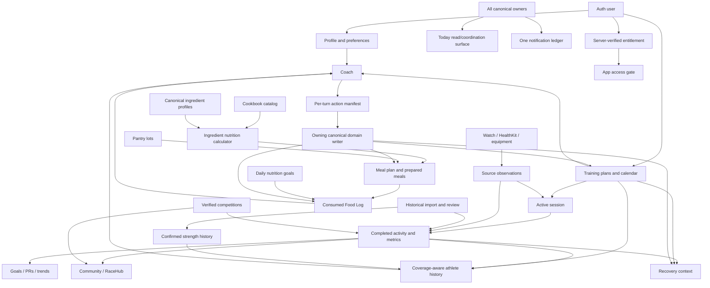

# ALL IN 365 V2 — Domain Ownership, Security & Event Contracts

**Status:** Working architecture matrix; schema/write decisions remain subject to ALL-222 review  
**Repository:** `allinproject/All-In-V2`  
**Branch at authoring:** `integration/v2-foundation`  
**Reference head at initial architecture write:** `768f2e99c1dec922d46955f982db836e78ea26d6`  
**Canonical backend:** Supabase project `xarhuczrtzuiljmtdaeu` (`All-In-V2`)  
**Project tracking:** Linear `ALL IN 365 — V2 Rebuild`  
**Last reconciled:** 2026-11-10

> This is an ownership and security contract, not a claim that the listed workspaces or tables have already been implemented. Only the explicitly listed foundation tables/functions currently exist. All future schemas require a separate migration, focused tests and domain-owner approval.

## 1. Binding product and architecture decisions

1. V2 is an independent application and backend. V2 Supabase is canonical from the first V2 account onward. V1 is read-only reference material for approved behavior, product data and lessons.
2. Create a fresh V2 account. Do not migrate V1 credentials, the single founder/test Coach thread, or personal V1 database rows by default. Optional user-authorized historical source import is a separate product capability (ALL-256/257), not account migration.
3. One canonical owner and one canonical writer per business action. Screens, Coach, Today and integrations are clients/readers of that owner, not parallel stores.
4. Coach may read, explain, navigate and propose. It never receives generic database mutation authority. Apply goes through an action manifest, explicit user intent and the owning domain writer.
5. RLS is enabled by default on exposed user/private data. Least-privilege grants are explicit. Private schemas are not API-exposed. No permissive policy is added merely to silence an advisor notice.
6. Distinguish catalog/product data, user-owned data, provider observations, imported data, derived values and model suggestions.
7. Missing/partial data is never coerced to zero. Preserve source, capture time, retrieval time, unit, preparation state, quality/coverage and derivation/version where applicable.
8. Planned workouts, active sessions and completed activities are distinct identities with explicit links. Device observations do not themselves become canonical workouts until validated by the owning flow.
9. Mutations are small, traceable and independently testable. A feature is not complete from source presence or mocked tests alone.
10. Approved App Art v2 and the five root tabs (Today / Fuel / Train / Community / Coach) remain closed product authority. Profile remains avatar/header accessed.

## 2. Current V2 backend and source — verified snapshot

### Applied V2 migrations

| Applied database version | Migration source | Current effect |
|---|---|---|
| `20261110021548` | `20261110000100_v2_auth_profile_legal_foundation.sql` | Auth-linked Profile, Settings, Onboarding, Legal Documents, Legal Acceptances and private profile-settings action ledger; owner read policies and canonical RPCs. |
| `20261110022457` | `20261110000200_v2_tighten_profile_privileges_and_legal_versions.sql` | Profile column-level update privilege, immutable published legal content, updated-at triggers and hardened legal/profile RPC behavior. |
| `20261110032039` | `20261110000300_v2_provider_cache_and_private_rls.sql` | RLS on the private settings ledger and provider cache; service-role-only cache RPCs. |
| `20261110101200` | `20261110000400_v2_onboarding_progress_writer.sql` | Private onboarding idempotency ledger and authenticated complete/skip/reset writer with expected-version and exact-retry behavior. |
| `20261110105423` | `20261110000500_v2_expected_owner_mutation_guards.sql` | Replaces Settings, Legal Acceptance and Onboarding mutation RPC signatures with database-enforced expected-owner checks against `auth.uid()`; drops unbound overloads. |
| `20261110122952` | `20261110000600_v2_provider_cache_expired_cleanup.sql` | Adds a bounded provider-cache purge API plus a private owner-only helper for scheduled cleanup. |
| `20261110124420` | `20261110000700_v2_provider_cache_cron_schedule.sql` | Installs pg_cron 1.6.4 and schedules hourly expired-cache pruning as postgres; public API wrapper stays service_role-only. |

### Current tables

| Table | Canonical owner | Classification | Direct client access | Mutation boundary |
|---|---|---|---|---|
| `public.v2_profiles` | Auth/Profile | User-private | Authenticated owner SELECT; only `display_name` and `avatar_path` UPDATE columns | Auth trigger creates row; column-limited direct update as currently approved. |
| `public.v2_profile_settings` | Auth/Profile settings | User-private | Authenticated owner SELECT only | `v2_patch_profile_settings_section`, with authenticated identity, allowlisted section, action ID and expected version. |
| `public.v2_onboarding_progress` | Auth/Profile onboarding | User-private | Authenticated owner SELECT only | Server-owned/versioned writer; direct client mutation not granted. |
| `public.v2_legal_documents` | Legal/Product operations | Product-published content | SELECT published/effective versions to anon/authenticated | Reviewed operator/server publication process; published content is immutable. |
| `public.v2_legal_acceptances` | Legal/Account lifecycle | User-private, immutable receipt | Authenticated owner SELECT only | `v2_accept_legal_documents` validates exact current published versions and owner. |
| `allin_private.v2_profile_settings_actions` | Auth/Profile settings idempotency | Private operational metadata | No anon/authenticated schema usage or table grants; RLS enabled; no policies by design | Only the owning settings RPC accesses it. |
| `allin_private.v2_provider_cache` | Provider infrastructure | Private cached external reference responses | No anon/authenticated/service-role table grants; RLS enabled; no policies by design | Service-role-only `v2_provider_cache_get/put/prune_expired` RPCs plus a private owner-only purge helper invoked by pg_cron as postgres. Cache is not canonical reviewed ingredient truth. |

The V2 project currently has zero rows in the verified eight-table foundation schema (five public and three private). No legal documents are published, so real signup remains intentionally gated.

### Current mobile source

The current V2 tree has an Expo Router/Auth shell, a progressive six-step onboarding wizard, typed Supabase public database types, pure feature-owned Cookbook and Training modules, and server-side USDA/OFF candidate-search Edge Functions. The Cookbook calculator/provider-independent arithmetic and Training plan/history/race-course/prediction contracts are source slices; ingredient profile persistence, recipe catalog, Training domain readers/writers and full live/device wiring remain separate acceptance work.

## 3. Canonical domain ownership matrix

Every domain must have exactly one canonical owner for its records and lifecycle. Issue IDs below are implementation owners, not evidence of completion.

| Domain / aggregate | Canonical owner | Owns | Must not own / duplicate | Primary consumers |
|---|---|---|---|---|
| Auth, Profile, account identity | ALL-216 / ALL-209; lifecycle extension ALL-251 | V2 identity, profile, session lifecycle, user settings, onboarding and account recovery | V1 identity/passwords; duplicated preference stores | All authenticated domains |
| Legal acceptance | ALL-216 / ALL-209; ALL-251 | Published legal versions, immutable user/version acceptance receipts and acceptance gate | Mutable acceptance receipts; legal copy embedded as app-only truth | Signup, Profile, billing and app access gate |
| Coach conversation/runtime | ALL-217 | Threads/messages, bounded settled context, task routing, provider/cost controls and model response provenance | Shadow copies of workouts, Food Log, goals, preferences or other canonical domain facts | Today and all user-facing workspaces |
| Coach safe actions | ALL-240 | Per-turn capability manifest, typed context, exact target/version, preview/apply authorization and result verification | Universal AI writer, model-generated table mutations or context-free object authority | Coach UI and every manual-domain writer |
| Goals and goal priorities | ALL-239 | Qualitative intentions, optional behavior targets, optional baseline/target measures, optional date windows, primary/secondary/maintenance relationships and revision history | Mandatory numeric targets/deadlines; duplicate sport metric or habit log; forced weight/calorie tracking | Coach, Training, Fuel, Kitchen, Recovery and Progress |\n| Training plans/calendar | ALL-246; Coach synthesis ALL-231 | Accepted plan revisions, calendar entries, sport-specific structured sessions (including Swim), native elliptical/stair sessions, authored multisport/brick legs and reviewed plan changes | Coach-owned plan copies; separate sport planners; universal modality conversion; inferred bricks; auto-rewriting accepted plans | Today, Coach, Recovery, Progress, Nutrition and Watch |
| Live sessions and completion | ALL-246; device capture ALL-245 | One active session identity, start/pause/resume/finish/cancel lifecycle, source observations and completion handoff | One separate workout per device/provider; duplicate manual/import history | Completed Activity, Progress, Recovery, Coach and Community proposal |
| Completed Activity and metric registry | ALL-243 | Canonical completed activity detail, sport-specific metric registry, provenance, samples/series, splits and analysis evidence | Provider-specific duplicate detail stores; values synthesized from absent source data | Progress, Recovery, Coach, competitions, Community |
| Athlete longitudinal history | ALL-232 | Bounded coverage-aware read model over canonical domain records | A parallel workout/history database or unbounded prompt dump | Coach, Progress, Nutrition, Recovery and Training |
| Food Log / daily Fuel | ALL-247 | Actual consumed intake, meal entries, quantities/units, daily nutrition goals and hydration logs | Suggested meals treated as consumed; second Coach diary; authored recipe macros | Coach, Today, Progress, Nutrition Calculator |
| Ingredient Database | ALL-228 | Canonical food identity, aliases, preparation-specific nutrient profiles, measurement bases, source provenance and review state | Provider cache as truth; recipe-owned copies of nutrient facts | Calculator, Cookbook, Fuel, Pantry, Coach |
| Cookbook / recipe catalog | ALL-218 | Product-owned recipes, ingredients/quantities, instructions, serving/yield, selectors/components and publication/readiness provenance | Authored recipe macro totals; user favorites/ratings in product seed | Calculator, Meal Plan, Meal Prep, Coach |
| Nutrition calculator / Cooking Yield | ALL-225 | Deterministic calculation from current reviewed ingredients, exact unit/basis and evidence-backed yields | Provider calls on routine recipe open; guessed conversions; stored catalog macro snapshots | Cookbook, Prepared Meals, Meal Plan and Coach |
| Provider adapters/cache | ALL-226 / ALL-227 | USDA/OFF discovery, exact product lookup, bounded server cache, source/licence/freshness and quota controls | Canonical ingredient review decisions; secrets in mobile app | Ingredient review/bootstrap only |
| Pantry / Shopping / Meal Plan / Meal Prep / Prepared Meals | ALL-248; cooked/raw rules ALL-229 | Raw/cooked/dry/prepared stock lots, non-edible Supplies, shopping projection, planned meals, freezer-kit component timing, prep batches and portion inventory | Duplicate Cookbook/Food Log inventory; raw/cooked interchangeability; guessing supply/ingredient usage or yield | Coach, Fuel, Today, Calculator |
| Recovery | ALL-238 | Recovery sessions/feedback and personalized recommendations from actual completed load, restrictions and current context | A second readiness score; recommendations based only on next planned session; silent plan mutation | Today, Training and Coach |
| Gear / Environment / route-specific preparation | ALL-236; route evidence ALL-234; location inventory ALL-251 | Owned equipment, multi-dimensional activity-derived use, role/feedback, session-time weather/environment recommendations and sourced terrain requirements | Automatic gear purchase/assignment; duplicate location inventory; false weather/UV/course facts; machine-specific levels treated as universal | Coach, Training, Today and Watch |
| Race/course/route evidence and strategy | ALL-234 | Canonical race/course identity, versioned field-level source evidence, route validation, structured aid/checkpoint/cutoff/crew/execution points and strategy attachment to exact plan/session revision | Invented aid stations/cutoffs; unversioned route facts; raw-coordinate leakage; route-only writes to Training | Training, Coach, Gear, Fuel, Watch, RaceHub |
| Community / RaceHub | ALL-244 | User-owned posts, audience/privacy, follow/block lifecycle, race participation and post linkage | Automatic posts from imports; editing by repost; second notification engine | Profile, Completed Activity, Competition, Coach |
| Verified sport competitions | ALL-253 | Weekly challenge identity/rules/windows, verified result evidence, eligibility and leaderboard integrity | Generic unverified workout claims or forcing leaderboards on every sport | Completed Activity, Watch and Community share |
| Notifications | ALL-237 | One event ledger, preferences, quiet hours, dedupe, delivery state, expiry, action/decline suppression | Independent feature-specific push systems or motivation spam | All domains, Today and Profile |
| Apple Watch / HealthKit / equipment | ALL-245 | Device permissions, observations, source identity, supported capability, phone/Watch session coordination and device acceptance | Provider-specific canonical workout stores; simulated hardware represented as real | Training, Completed Activity and Progress |
| Historical athlete import | ALL-256 | Optional source discovery, coverage preview, import orchestration, provenance, dedupe and review state | V1 account migration; duplicate canonical history; retroactive social posts | Activity, Progress and Coach |
| Strength onboarding/history import | ALL-257 (child of ALL-256) | Confirmed exercise/set/load baselines and reviewed image/export/manual import drafts | OCR/model output as authoritative set history; invented PRs | Training, Coach, Recovery and Progress |
| Exercise Library / guided Strength | ALL-258 | Canonical movement identities, variations, equipment requirements, written cues, optional licensed demo mapping and exact guided phone/Watch set workflow | Provider-specific exercise IDs, duplicate set history, required paid beta video, unlicensed media | Training, Coach, Watch, Recovery and Progress |
| Progress / PRs / achievements | ALL-249 | User-facing trends, goal evidence, comparable records, distinct Badges / PRs / Milestones and reviewed award evidence | A second source-of-truth activity/result database; engagement/weight-loss/recovery streak trophies; unsupported PRs | Today, Coach and Profile |
| Today / global navigation | ALL-250 | Coordinated daily read/coordination surface, contextual entry points, five-tab navigation, limited secondary-card customization and canonical snapshot freshness | Another planner, domain writer, stale/conflicting derived state, persistent duplicate cache or sixth root tab | All workspaces |
| Profile privacy / export / deletion / support | ALL-251 | Privacy controls, consent, connection status, scoped export/deletion, support/feedback route | Duplicate Auth/settings store; undocumented retention assumptions | All user-owned domains |
| Subscription / entitlements / referrals | ALL-252 | Server-verified entitlement state, trial/purchase/restore/refund lifecycle, referral attribution and reward ledger | Client-asserted paid state; unsupported SKU or free/ad tier | Auth/access gate, Profile and billing support |
| App complexity / footprint | ALL-255 | Progressive disclosure standards, lazy-load, cache/media bounds, dependency and build footprint measurements | A feature-specific state store or capability removal based only on inactivity | All app workspaces |
| Whole-app UI/UX acceptance | ALL-254; Coach E2E ALL-241 | Route/control/journey inventory, evidence ledger, device/accessibility/privacy acceptance | A separate component system or replacing domain-owned test suites | Release/beta acceptance |
| Cross-domain integration | ALL-242 | Athlete lifecycle, shared derived-state/version/freshness contract, feedback-loop and maturity evaluation; Built/Working/Integrated/Validated/Optimized evidence | Duplicate implementations or independent conflicting calculations in each surface | All canonical owners |

## 4. Read/write and cross-domain contract

### Canonical writer

Each mutating domain operation must document:
- Domain and exact aggregate owner.
- Authenticated actor/owner key and permission check.
- Target ID and exact expected revision/version when the target is versioned.
- Caller-generated action/idempotency ID.
- Typed, validated domain payload; no generic JSON mutation endpoint.
- Explicit confirmation level: direct supported action, review-only proposal, or destructive/sensitive confirmation.
- Canonical writer/RPC/Edge function and its allowed execution role.
- Authoritative result containing canonical object ID, resulting revision/version and any dependent-state refresh requirement.

An exact retry returns the original outcome. Reusing an action ID with a different target or payload fails closed. A stale revision returns a conflict and requires a fresh read/preview. Cancel before apply leaves canonical state unchanged. A model response or client optimistic update is not evidence of a successful write.

### Coach

Coach obtains task-gated, bounded context from canonical owners. It preserves source identity, timestamp/recency, coverage and provenance. Its per-turn manifest (ALL-240) limits actions to those the current authenticated host context authorizes. For an applied action, Coach must read back the changed canonical object/version before saying it saved.

### Today and Progress

Today and Progress are read/coordination or presentation consumers. They link to exact domain-owned objects and do not write shadow copies. Today surfaces safety-critical and relevant next actions without duplicating whole workspace detail. Progress derives comparable trends and achievements from evidence-backed canonical records.

### Imported and device data

Provider/device observations remain provenance-bearing source records until the owning domain validates and links them to canonical identity. Duplicates across HealthKit/direct providers/imports are reconciled to one canonical activity with retained source lineage. Importing history never creates a Community post or race registration automatically.

### Shared derived-state snapshots and freshness

Any derived state shown in more than one surface (for example Recovery/load interpretation, current plan state, Gear usage or race-strategy status) must have one canonical calculation/snapshot contract with a version and effective timestamp. Today, Train, Progress, Coach, Community and Watch consume the same version rather than independently recomputing conflicting values. If detail is fresher than a cached summary, refresh the summary or label it stale. Provider/device snapshots never overwrite newer canonical facts solely because they arrived later; source-precedence and merge rules remain explicit. Coach receives the same freshness/version evidence and must avoid confident adaptation from stale or conflicting signals.

### Cross-domain training and race semantics

- Cross-training is suggestion-first and must explain purpose, change, lost sport specificity and user choice. No universal run/bike/swim/elliptical/stair conversion. Completed alternative training contributes stress under its own sport identity but not primary-sport mileage or PRs.
- Triathlon is one athlete with linked, explicit Swim/Ride/Run legs and transition segments. A brick is an authored linked session, not two unrelated activities merged by proximity.
- Weather changes execution/environment before training purpose: keep a safe session, adjust effort/route/gear, optionally shift time, use a confirmed same-sport indoor alternative, then consider purposeful cross-training or reschedule. Explicit user preferences govern ordinary discomfort; official safety conditions override them. No silent calendar mutation.
- Race checkpoints, aid stations, cutoffs and crew/execution notes are structured, versioned facts with field-level sources; never invent facts or leak raw route coordinates outside the approved context contract.
- Badges are collectible achievements, PRs are best comparable performances and Milestones are cumulative totals. These are not interchangeable; engagement/weight-loss/recovery streaks and overtraining rewards are excluded.
- Freezer-kit packaging is non-edible Supplies with its own Pantry quantities and usage timing. Supplies never enter recipe nutrition or edible yield calculations.

## 5. Security and privacy contract

### Schema and role boundary

- `public` is an exposed schema: every user-owned table requires RLS, explicit policies and reviewed grants.
- `allin_private` is not exposed to `anon` or `authenticated`. Keep schema USAGE and direct table privileges revoked. RLS is enabled as defense-in-depth.
- A private table with RLS enabled and no policies is intentional only when no API role has direct schema/table access and access occurs through a narrowly scoped server-owned function. Do not add a permissive policy to silence an informational advisor finding.
- Provider cache is server-side operational data. Only the service-role cache RPC may access it; the mobile client never receives provider secrets or direct cache-table access.
- Use explicit grants, revoke default PUBLIC execution where appropriate and review function ownership/role at every schema slice.

### Expected actor identity on every user-scoped mutation

For every client-originated mutation of user-owned data, the typed RPC must receive the screen/request's captured expected owner UUID (for example `p_expected_user_id`) and compare it to `auth.uid()` inside the database before any lookup, idempotency replay, lock or mutation. Reject NULL/mismatched identities (SQLSTATE `42501`). A client-side `getSession()` check is useful UX protection but is not the authorization boundary because the session may change between the check and the request reaching PostgREST.

Do not leave an older unbound RPC overload executable alongside the guarded signature. Drop/replace it, revoke PUBLIC/anon/service_role execution explicitly, and grant only the intended authenticated role. A server-to-server/service-role writer uses a distinct explicit actor/capability contract; it must not inherit a client user-writer bypass. Include an Account A JWT + Account B expected-owner negative test for every owner-scoped mutation and test a correct-owner call still succeeds.

The currently deployed Auth/Profile/Legal/Onboarding mutation RPCs implement this rule in migration `20261110000500_v2_expected_owner_mutation_guards.sql`. Every future Coach, Training, Food, Recovery, Community, Progress, Gear, Billing and account lifecycle writer inherits this requirement.

### SECURITY DEFINER boundary

A SECURITY DEFINER function in an exposed schema is an API endpoint, not a private helper. It must:
- Have a fixed empty or otherwise tightly controlled search path and schema-qualified object references.
- Check authenticated identity in its body using `auth.uid()` when it is a per-user operation.
- Bind all reads/writes to that exact owner and validate every object/revision/action input.
- Have EXECUTE revoked from PUBLIC/anon; grant authenticated only when that per-user API is intentionally part of the client contract. Service-only operations are service-role-only.
- Never become a generic privileged table proxy.
- Be covered by owner-isolation, unauthorized access, replay, changed-payload, stale-version and failure-path tests.

The three currently exposed authenticated SECURITY DEFINER functions — `v2_my_profile_state`, `v2_accept_legal_documents` and `v2_patch_profile_settings_section` — are intentional per-user APIs and currently check `auth.uid()`. Supabase's advisor warns because they are callable by authenticated users; retain the least-privilege contract and test the body/owner boundary. Current private-table INFO notices for RLS-with-no-policy are expected under the private-schema posture. See ALL-223's recorded live verification.

### Data classes

Use these as a classification vocabulary; each domain must finalize field-level classification before its migration:
- **Public product reference:** published legal docs, reviewed cookbook catalog and explicitly public competition rules.
- **User-private:** profile, preferences, plans, sessions, health/activity data, Food Log, Pantry, gear, recovery and private progress records.
- **User-shared with audience controls:** Community posts, comments, race profile/participation and approved competition presentation.
- **Private operational:** idempotency ledgers, provider cache, internal job state and server-only audit/telemetry.
- **Derived/transient:** calculations, predictions, route estimates and Coach analysis; retain provenance and do not silently promote to canonical facts.

### Retention and deletion

Do not invent one global retention period. Each owner must specify retention, archival, deletion/anonymization and legal-hold behavior for its data class. ALL-251 coordinates user-visible export/deletion and provider disconnect, while domain owners implement actual owner-scoped cleanup. Preserve legally required immutable records according to the separately reviewed policy; do not assume all user records or all audit data can be deleted identically.

## 6. Shared event and identity rules

- Use stable domain-owned IDs. Cross-domain relationships reference those IDs; they do not duplicate aggregate truth.
- Keep planned workout ID, active session ID, completed activity ID, provider observation ID and import job ID distinct.
- Keep race event identity, course version, registration/participation state and result evidence distinct.
- Keep ingredient identity, product/GTIN identity, preparation-state profile, recipe-line identity, Pantry lot and prepared-meal portion distinct.
- Keep suggested meal, planned meal, prepared portion and consumed Food Log entry distinct.
- Keep source record, imported observation, user-confirmed correction, derived metric and Coach recommendation distinct.
- Every event that can be retried needs an idempotency contract. Events that can arrive out of order must check aggregate revision/state before applying.

## 7. ER / ownership overview

This is a domain relationship map, not a final physical schema. Relationship cardinalities, table names and FK definitions must be finalized by the owning schema slice.

## 8. Required test contracts by domain

Every domain issue must add focused tests for:
- Owner A cannot read or mutate Owner B's private records.
- Anonymous and authenticated access matches the reviewed classification and grants.
- Direct client writes are denied where mutations are RPC/server-owned.
- Exact retry is idempotent; reused action ID with changed target/payload fails.
- Stale version, duplicate event and out-of-order delivery are rejected or reconciled explicitly.
- Account switch/session expiry/revoked permission cannot leak cached or private state.
- Missing/partial/unknown data stays unknown rather than zero or fabricated.
- Cancellation does not mutate canonical state; successful apply returns and reads back the authoritative new revision.
- Provider outage, network failure, process death and retry do not duplicate or corrupt canonical records.
- Mocked, isolated SQL, authenticated integration and physical-device acceptance are labeled separately.

## 9. Current dependency and maturity gates

| Work | Current evidence | Gate / next action |
|---|---|---|
| ALL-216 Auth/Profile/Legal foundation | Three V2 migrations applied; empty project schema verified; no published legal docs | Continue clean rebuild/reproducibility, live client/session and approved legal review. |
| ALL-223 private-schema RLS | Done; migration 003 applied, private RLS/grants and authenticated writer replay verified | Keep advisor exceptions documented; do not weaken private grants. |
| ALL-222 architecture | Existing Coach/Cookbook specs and this cross-domain matrix | Owner review, ERD/schema mapping, per-domain read/write/RLS matrix and test ownership before dependent domain migrations. |
| ALL-224 reproducible engineering | Package scripts exist; no lockfile/install/typecheck/Expo build evidence yet | Generate one canonical lockfile, clean install, run test suites/typecheck/Expo bundle and CI. |
| ALL-217 / ALL-231–241 Coach | Pure source slices and exact V1 v18 reference preserved; live V2 wiring remains separate | Finish domain schema dependencies, V2 readers/writers, runtime adaptation and scenario acceptance. |
| ALL-218 / ALL-225–229 Cookbook | Pure calculator/yield code and provider adapters exist; ingredient/catalog schema and seed remain outstanding | Approve ingredient identity/profile/yield ownership, implement schema and review/seed workflow, then validate runtime tests. |
| ALL-243–258 whole-app slices | Dedicated owners now exist; these are backlog requirements, not implemented work | Begin only after ALL-222 owner/schema/security approval; use small vertical slices with exact acceptance. |

## 10. Additional Strength, equipment-location and sport-structure requirements

- ALL-251 owns named Training Locations and one confirmed equipment inventory per location. Manual entry is always available; optional image/video/Bluetooth recognition is draft-first and requires user review/confirmation. Unknown weight/capability stays unknown. Minimal-equipment/home/bodyweight users are valid. Training and Exercise Library consume the selected location; Coach offers the smallest compatible substitution and preserves accepted workout structure. Do not create a second equipment inventory.
- ALL-258 owns canonical exercise IDs, movement variants, equipment requirements, written cues and optional media mapping. Beta must not require a paid exercise-video provider; a placeholder/static illustration is valid and logging remains complete. Public-launch media must be properly licensed and replaceable without changing exercise/history IDs.
- ALL-246 owns structured Swim sessions (typed send-off vs fixed-rest, pool length/unit, sets/reps/stroke/effort/equipment, pool vs open-water, purpose-specific authoring), native elliptical/stair-stepper sessions and linked multisport/brick plan identity. ALL-245 owns device execution and real Watch/equipment acceptance. ALL-243 owns source-truthful metric detail.
- Swim CSS is optional only when based on a reviewed protocol or explicit trusted athlete/provider value with course/unit/source/date/version. Drill/kick/manual-credit completion is not equivalent to sensor-measured distance. Missing pace/stroke/SWOLF/technique data stays unknown.
- Elliptical and stair-stepper remain distinct sport identities. Machine levels are device-specific; distance, floors, steps, vertical, watts and energy are recorded only when explicitly supplied. No running-mile or generic cross-sport conversions.
- Triathlon is one whole athlete with primary Swim/Ride/Run disciplines and linked authored legs/transitions. Do not create three independent plan engines, infer bricks from nearby unrelated activities or allow one discipline's assessment to overwrite another's zones.
- Cross-training is suggestion-first; explain purpose, specificity trade-off and give Use / Keep / Ask Coach choices. Completed cross-training contributes to whole-athlete stress under its own identity, not primary-sport PR/mileage.

## 11. Explicit unresolved decisions (do not silently guess)

Before any new domain migration, the owner and ALL-222 must resolve:
1. Exact aggregate/table/column layout, ID strategy, FK constraints and indexes.
2. Owner key and any shared/public audience model.
3. Field-level data classification, retention, deletion/anonymization and export behavior.
4. Direct read grants versus bounded read RPC/view; direct writes versus domain writer.
5. RLS policies, function ownership, SECURITY DEFINER necessity, grants, fixed search paths and API exposure.
6. Expected-version and idempotency key scope, conflict response and event retry semantics.
7. Provider/source lineage and missing/partial data representation.
8. Test owner, migration reset/replay evidence, authenticated two-user SQL tests and device requirements.

No issue creation, roadmap mention or UI mock is a substitute for resolving these decisions. No deployment, public signup, billing activation, main-branch change or release-gate relaxation is authorized by this document.

## 12. Authored plan, approved modification, live execution and completed evidence

These are separate states, not interchangeable copies of one workout:

1. **Authored prescription:** canonical workout/session plan with stable step/block/leg IDs, intended purpose, prescribed targets, exact structure and source plan revision.
2. **Approved modification:** explicit user-approved change to the authored prescription (for example a shorter session, swapped movement, changed workout time, adjusted interval target or weather-based same-sport alternative). Preserve original prescription, reason/evidence, actor, approval and resulting revision.
3. **Live execution:** session events and actual performed values, including pauses, skips, repeats, early/late transitions, effort changes, sensor source changes, device dropouts and manual corrections. These never silently rewrite the original prescription or retroactively imply that a planned step was completed.
4. **Completed evidence:** canonical completed activity with actual duration/distance/metrics and source/provenance, linked to the authored plan revision and any approved modifications plus actual execution events. It is the basis for Progress, PRs, Recovery and Coach's later adaptation.

A shortened/extra/free workout is still a real completed activity when validated, but it is not a completion of an unperformed planned step. Planned load, approved modified load, live executed load and completed measured load remain distinct, queryable contributions. Missed/shortened work is not automatically made up, stacked or counted as completed stress.

## 13. Sport-specific execution and device-quality boundaries

- **Running / track:** authored intervals retain stable step identity. Track sessions may allow manual advance at the actual line/lap rather than GPS auto-advance when measured distance is unreliable. Open warm-up/arrival-to-start may precede authored steps without changing the core workout.
- **Swim:** explicit timing mode (send_off vs fixed_rest), pool length/course unit, sets/reps/stroke/equipment and technique purpose. CSS is only a trusted/reviewed optional anchor with source/protocol/date/version. Manual drill/kick credit is separate from sensor-measured distance. Preserve equipment context and like-for-like technique comparisons.
- **Indoor cycling:** keep Workout / Free Ride / Course / Competition as distinct modes and reuse one canonical session/equipment state. Structured workout views surface current/target power, remaining interval, HR/zone, cadence, total time, next step and actual control state when supported. Authored step IDs survive ERG/manual mode changes, skips/repeats and bounded target adjustments. FTP is a threshold anchor, not a complete power profile; a multi-duration capability profile requires adequate trusted efforts. FTP changes are proposals showing prior/new values, source/confidence and downstream effects; one failed/hot indoor session never silently changes FTP or upcoming targets. Power source and trainer control capability are separate facts. Calibration is device-specific. Sensor/trainer disconnect cannot leave the UI claiming ERG/control remains active.
- **Cross-training:** alternatives preserve intent where possible but remain explicit suggestions. They do not convert run miles into bike/swim/elliptical/stair equivalencies or write primary-sport PR/mileage.
- **Strength:** stable exercise/set/block identity, accepted supersets/rounds/program progression, exact set corrections and session feedback. Exercise substitutions must preserve purpose/approved structure and use confirmed Training Location equipment. Unknown working weights remain unknown.
- **Watch battery/offline:** prefer platform workout-session primitives, avoid unnecessary polling/network/UI churn, do not run GPS for indoor sessions, and use haptics only for actionable events. Required workout steps/zones/route/checkpoint data are cached before start where supported. Any long-session battery-saver mode must disclose reduced sampling and weakened metrics/alerts rather than silently changing their reliability. Battery comparisons and ultra-duration claims require duration-matched physical-device evidence.

These distinctions are owned by ALL-246 (authored plans/session lifecycle), ALL-240 (approved safe action/apply), ALL-245 (device/session execution), ALL-243 (completed metrics/provenance), ALL-232 (history/retrieval), ALL-258 (exercise/set structure), and ALL-231 (Coach planning/adaptation). No new workout/session history store is permitted.

## 14. Recovery, nutrition and source-coverage trust

### Recovery snapshots and adaptation

- Morning Recovery is a bounded timestamped snapshot of available overnight/recent evidence. A later live-day condition is a separate snapshot with its own effective time/source/version. Never rewrite morning's original state so it appears the athlete had that value all day.
- A compact interpretation and today's recommendation come first; supporting HRV trend, resting HR, sleep quantity/quality/debt, recent completed load and optional subjective context remain one layer deeper. Missing, contradictory or stale signals reduce confidence or produce unavailable/unknown; they do not become a precise-looking default score.
- When a planned session exists, Recovery answers whether today's demand still fits. If it does, preserve the plan. If evidence supports a change, propose intensity/duration reduction, same-purpose substitution, move/reschedule or rest through the reviewed Training writer. Readiness informs the accepted plan; it is not a second training plan or automatic readiness gate.
- Optional user journal context (travel, illness, stress, late meal, caffeine/alcohol timing, soreness and other chosen inputs) may be analyzed only with adequate sample count and data quality. Use associative wording unless causality is actually established. One-off correlations are not user traits.
- New users, new devices, sparse data and long sync gaps have a baseline-establishing/low-confidence state. Glanceable widgets/Watch cards consume the same canonical Recovery snapshot/version, not a second engine.
- Subjective athlete check-in is evidence alongside wearable/model output. It neither blindly overrides nor is ignored by the model. Illness/pain/safety policies remain authoritative.

### Nutrition accuracy vs completeness

- Exact package/brand identity and label review are separate from nutrient completeness. A "label reviewed" status means visible package-label values were checked; it does not imply a complete micronutrient profile.
- Preserve coverage/completeness and source class for exact branded package, generic composition data, community/unverified product, custom/user-entered food, estimated recipe component and canonical PreparedBatch snapshots. Missing micronutrients remain unknown, never zero.
- Exact branded/package entries take precedence for their label-listed data when logging that package. A generic composition record may be preferable for a whole/common food when deeper micronutrient composition is needed; do not silently replace a logged branded item with a generic equivalent.
- Custom foods remain private user-authored truth with exact source/correction lineage. Coach micronutrient patterns require sufficient entry/day coverage; partial label coverage cannot support confident deficiency/excess claims.
- The ordinary Food Log remains low-friction; source/coverage explanation belongs in Nutrition Details or a trust affordance. This is a quality/coverage contract on the existing Ingredient/Food owners, not another nutrition DB.

## 15. Availability, cross-training and weather adaptation

- Current sustainable weekly volume and recent long-session history are distinct from desired future weekly/long-session targets. Volume trajectory preference and quality-session difficulty preference are independently user-controllable, bounded by evidence/safety.
- Actual trustworthy completion, including free/shortened/extra sessions, feeds completed history. Planned/forecast work remains separate. Repeated divergence can prompt review; a one-off miss is not lost fitness and never triggers make-up stacking.
- Temporary travel/vacation/reduced availability, B-race/tune-up and feeling unwell are bounded plan/context inputs. Preserve the primary event hierarchy and prior plan history. A replacement plan must transition from the athlete's current confirmed state, not restart from week one.
- Cross-training is suggestion-first and selected only when it solves a meaningful constraint. Explain intended stimulus, what changes and sport-specificity lost; offer use/keep/ask. No one-for-one time/distance/mileage conversion. A completed alternative contributes to whole-athlete load under its own sport identity but cannot become a primary-sport PR/mileage.
- Weather changes the environment before it changes workout purpose: keep a safe planned session, adapt effort/route/gear, optionally move time, use confirmed same-sport indoor equipment, then consider purposeful cross-training or reschedule. Ordinary comfort preference is sport-specific and explicit preferences outrank inferred preferences; safety-critical official conditions override comfort preference. Weather data must be tied to the workout time/coarse approved area and freshness. Provider failure means weather unavailable, not safe.
- Weather suggestions never silently mutate the calendar. Repeated forecast changes must be debounced, and a missed weather session is not automatically made up later.

## 16. Watch interaction and media-control boundary

- Watch is an execution companion that removes phone friction during movement, not a compressed phone dashboard. The current action/metric, next step and critical status dominate. Phone owns deep analysis, complex plan/course authoring and Community composition.
- Watch media integration uses platform-supported playback controls/deep links and the user's existing streaming app/session. ALL IN does not create a music catalog or duplicate streaming account service. Media controls remain optional and must not block workouts.
- Optional audio Coach cues may be useful later, but the complete workout flow must remain readable and operable without audio. Cues must be short, contextual and must not obscure live metrics or interrupt critical execution.
- Battery release gates and offline execution requirements in Section 13 apply to every supported sport; simulated device fixtures cannot count as physical acceptance.

## 17. Product-scope evidence guardrail

The V1 backlog contains many competitive research/design handoffs that explicitly disclaim live implementation, physical-device validation or release readiness. V2 transfer must preserve those scope labels: a requirement or research finding is not evidence that a feature was shipped or validated. Each issue/report must distinguish source-presence, deterministic/unit tests, authenticated integration, live provider, and physical-device acceptance.

## 18. Physical ERD and live security matrix — deployed Auth/Profile/Legal foundation

A separate physical schema record is now committed and verified against the live V2 Supabase catalog:

[docs/architecture/V2-AUTH-PROFILE-LEGAL-PHYSICAL-ERD-AND-SECURITY-MATRIX.md](https://github.com/allinproject/All-In-V2/blob/integration/v2-foundation/docs/architecture/V2-AUTH-PROFILE-LEGAL-PHYSICAL-ERD-AND-SECURITY-MATRIX.md)

Commit: `3f071af97d56943a63147ed910c9fc114caa40ae`.

This physical slice now covers the eight deployed tables: Profile, Settings, Onboarding, Legal Documents, Legal Acceptances, private Settings and Onboarding action ledgers, and private Provider Cache. It records exact deployed migration version mapping, table columns/types/keys/FKs/indexes/checks, physical ERD, all public RLS policies, role/column grants, SECURITY DEFINER function EXECUTE grants/search paths/owner checks, and trigger map. The live catalog confirms all eight tables currently contain zero rows; no legal documents have been published.

Onboarding now has a dedicated authenticated versioned writer and private idempotency ledger (migration 004 below). The actual six-step user interface/client integration remains outstanding. Legal publication is operator-controlled and remains unpopulated.

This completes the physical ERD/security record for the deployed foundation slice. **It does not complete ALL-222's entire acceptance.** Each future Coach, Cookbook, Training, Food, Recovery, Community, device, billing and privacy schema still requires its own reviewed physical object/policy/function matrix before DDL. ALL-224 still owns clean-reset/type generation/npm install/CI/app validation; those checks are not claimed passed here.

## 19. Onboarding writer implemented and replay-verified — 2026-11-10

The deployed foundation now includes:

- Migration source: `supabase/migrations/20261110000400_v2_onboarding_progress_writer.sql`
- Applied Supabase migration: `20261110101200` (`v2_onboarding_progress_writer`)
- Canonical mutation RPC: `public.v2_set_onboarding_step(step, action, expected_version, client_action_id)`
- Private idempotency table: `allin_private.v2_onboarding_actions`
- Repeatable SQL replay fixture: `supabase/tests/v2_onboarding_progress_writer_replay.sql`

The writer supports one allowlisted step per call and `complete`, `skip` or `reset`. It uses authenticated `auth.uid()`, per-user transaction serialization, an expected-version guard, a private per-user idempotency ledger and exact retry replay. Changed-action-ID reuse fails closed. Repeating an already-current state with a new action ID records the outcome without a needless version bump. Completed/skipped arrays remain in the canonical six-step order and cannot overlap. The overall completion timestamp is set only when every required step is either completed or skipped, and is cleared when any step is reset.

The authenticated SQL replay passed against two temporary Auth users:
- First completion advanced version 1→2.
- Exact retry returned version 2.
- Same-state no-op retained version 2.
- Reusing an action ID with changed step/action was rejected.
- Stale expected-version write was rejected.
- Skip advanced version 2→3.
- Reset advanced version 3→4 and removed the completed step.
- A retry of the original version-1 action after version 4 still returned its original version 2.
- Direct authenticated INSERT/UPDATE was denied.
- User B could not read User A's progress and could mutate only User B's row.
- The SQL transaction rolled back; synthetic users, progress rows and action-ledger rows all returned to zero.

Live privilege/catalog verification confirms the new private ledger has RLS enabled, no policies, no schema/table access for anon/authenticated/service_role, and is reached only by the authenticated SECURITY DEFINER writer. The function is postgres-owned, uses an empty search path and checks auth identity. The security advisor now reports three intentional private-table no-policy INFO notices and four authenticated per-user SECURITY DEFINER WARN notices.

**Onboarding UI implementation added:** `apps/mobile-v2/app/onboarding-required.tsx` now implements a short, resumable six-step wizard (focus, current training pattern, availability, Coach guidance, food safety and proactivity). Explicit answers are stored in the owning existing Settings sections using `v2_patch_profile_settings_section`; progress uses `v2_set_onboarding_step`. Every step may be skipped without writing placeholder values; Back edits a prior answer; current Auth session is verified before each write; state is re-read after successful progress. No blanket OS permission prompt is shown. Pure helper tests cover resume, unknown/skipped values and answer-to-settings ownership.

**Remaining acceptance:** the full auth/onboarding test suite, TypeScript compiler, installed iPhone/session/account-switch flow and visual/accessibility acceptance have not run yet. Do not call the UI validated until those checks pass.

## 20. Generated public database types wired into the V2 client — 2026-11-10

Supabase TypeScript types were generated from the live V2 project after migration `20261110101200` and committed to `apps/mobile-v2/src/types/database.types.ts`. The generated contract contains five public tables and six public RPCs, including `v2_set_onboarding_step`. The private `allin_private` schema is intentionally excluded from mobile client types because it is not API-exposed and has no direct client grants.

The existing `src/lib/supabase.ts` client now uses `createClient<Database>` with the generated type. Auth persistence, native storage, auto-refresh and environment variables were otherwise left unchanged.

This is generated schema alignment, not a typecheck/build result. ALL-224 still requires a network-enabled clean checkout, canonical npm lockfile, install, unit test suites, TypeScript check, Expo bundle and CI.

## 21. Typed access-gate client alignment — 2026-11-10

The access-gate data reader now accepts `SupabaseClient<Database>` from the generated public schema type (`apps/mobile-v2/src/auth/accessGateClient.ts`, commit `5c9cf7c666218c1710408c992492f23cd41d1b11`). This ensures `v2_my_profile_state` is resolved through the generated RPC contract. The shared client, sign-up/legal public-table reads and legal-acceptance RPC calls all use the same typed Supabase client. AuthProvider retains its existing Auth-only usage.

This is static source alignment, not a successful TypeScript compiler run; ALL-224 still owns the reproducible typecheck gate.

## 22. Progressive six-step onboarding UI implementation — 2026-11-10

The placeholder route was replaced with a short resumable flow using the locked design direction (do not front-load settings; skipped optional fields stay unknown; no permission prompts on first launch; return existing users to Today once access gates pass).

Implementation:
- `app/onboarding-required.tsx`: six-step wizard, prefill from existing Profile Settings, Back, Skip, Continue, retryable failures, session-owner verification before both writes, refresh from `v2_my_profile_state` after each progress mutation.
- `src/auth/onboardingFlow.ts`: canonical first-incomplete selection, required-answer validation and typed answer-to-settings mapping.
- `src/auth/onboardingFlow.test.ts`: four focused tests for resume order, blank/unknown answers, ownership mapping and optional food-safety notes.
- `package.json`: added the onboarding flow tests to `test:auth`.

Explicit answer destinations use the existing Settings owner: Training focus/current sports/availability → `training_preferences`; Coach style → `coach_preferences`; food-safety selection/details → `nutrition_preferences`; reminder preference → `notification_preferences`. Progress remains in `v2_onboarding_progress`. No new schema or preference store was added. Device permissions remain contextual and are not requested by this wizard.

The four pure onboarding helper tests passed in an isolated Node 22.16 type-stripping harness. This is not yet the full repository `npm run test:auth`, TypeScript typecheck, Expo build, live signed-in UI journey or physical-device acceptance; those remain ALL-224/ALL-209 acceptance.

## 23. Authenticated identity checks around auth-sensitive writes

A reusable client guard `assertV2SessionOwner(client, expectedUserId)` is defined in `apps/mobile-v2/src/auth/accessGateClient.ts`. It reads the active Supabase session and fails closed if the account is signed out, switched or unavailable; lookup errors propagate rather than being treated as a valid identity.

Use this guard immediately before auth-sensitive writes and before continuing after an awaited write where a screen may have remained mounted during an account switch. It is now used by:
- Onboarding before both the Profile Settings preference write and onboarding-progress mutation.
- Signup before writing the acceptance receipt for the newly created account.
- Legal acceptance before and after the legal receipt RPC.

Three new unit cases cover the matching identity, missing/switched identity and session lookup failure. The shared guard reduces divergent account-switch behavior across screen-specific write flows. This source-level integration is not yet a mounted race test or installed-device acceptance.

The V2 route/auth-provider source scan found and fixed invalid bare theme-object JSX props in both the sign-in and root loading indicators. The source scan then returned no remaining instances of the checked invalid JSX attribute pattern. Do not substitute source scans for TypeScript/Expo compilation.

## 24. Database-enforced expected-owner identity for mutation RPCs — 2026-11-10

A client-side session check alone cannot close the race between `getSession()` and the subsequent PostgREST request: the bearer token can change after the check and before the database receives the RPC call. The mutation API therefore also carries the screen's captured expected owner UUID and checks it against `auth.uid()` inside PostgreSQL.

Applied migration:
- `supabase/migrations/20261110000500_v2_expected_owner_mutation_guards.sql`
- V2 migration version `20261110105423` (`v2_expected_owner_mutation_guards`).

The three user-scoped mutation RPCs now require `p_expected_user_id` and fail with `42501` before any operation if it is null or differs from the authenticated actor:
- `v2_patch_profile_settings_section`
- `v2_accept_legal_documents`
- `v2_set_onboarding_step`

Old unbound signatures were dropped, preventing clients from bypassing this check through an older overload. All existing expected-version, per-user lock, legal-version and idempotency semantics remain intact. Authenticated-only EXECUTE grants remain; each function remains postgres-owned, SECURITY DEFINER with an empty search path.

Client call sites now provide the screen-captured owner ID from onboarding, signup and returning-user legal acceptance. This complements (does not replace) the shared `assertV2SessionOwner` client guard. Even if the auth session changes after the client check, the database compares the captured owner against the token's current `auth.uid()` and rejects the write.

Rollback-only SQL tests:
- `supabase/tests/v2_expected_owner_mutation_guard.sql` exercises wrong-owner rejection for all three RPCs and correct-owner progression.
- `supabase/tests/v2_onboarding_progress_writer_replay.sql` retains full complete/skip/reset, idempotency, stale-version and two-account isolation coverage using the new expected-owner signature.

Both passed against live V2 with no SQL error. Post-rollback verification: zero synthetic users, progress/settings/legal rows and action-ledger rows. Live catalog check confirms the old signatures are absent and the new signatures have authenticated-only EXECUTE. The regenerated public database types include the expected-owner argument on all three RPCs.

## 25. Signup email confirmation and password recovery deep links

Slice 1 now includes:
- `app/auth/callback.tsx` for PKCE email confirmation and reset-link exchange.
- `app/forgot-password.tsx` for generic password-reset requests (does not disclose whether an address exists).
- `app/reset-password.tsx` for setting the new password under the recovered session, with the shared expected-session owner guard.
- Signup supplies `emailRedirectTo: Linking.createURL('/auth/callback')`.
- Password-reset supplies `Linking.createURL('/auth/callback', { queryParams: { type: 'recovery' } })`.
- The callback resolver routes confirmation to the existing root/access gate and recovery to the reset-password screen; all flows exchange the one-time PKCE code with `exchangeCodeForSession`.

The existing Expo scheme is `allin365v2`. The V2 Supabase Auth Redirect URLs allowlist must include `allin365v2://**`. The Supabase project-details API available in this execution environment does not expose the Auth redirect allowlist, so this setting remains externally unverified/unconfigured until checked in the Supabase Auth dashboard. Native deep-link acceptance must use a development build or installed app; Expo Go uses a transient development URL.

Pure callback resolver tests pass for signup/email confirmation, recovery routing, missing code and provider errors. Actual SMTP delivery, redirect allowlist, phone link handling, password update and email-confirmation-to-legal-gate remain unvalidated until configured and tested on device.

## 26. Explicit PKCE configuration for native email auth deep links

The shared V2 Supabase client now sets `auth.flowType = 'pkce'` with `detectSessionInUrl: false` and performs an explicit code exchange in `app/auth/callback.tsx`. This is deliberate: Supabase JS defaults to implicit flow in a client-only JavaScript app, while the callback implementation consumes a PKCE authorization code. The existing `expo-sqlite/localStorage/install` provides persistent storage for the code verifier on the originating device. The one-time code must be redeemed on that same device where the flow began.

Do not change this client to implicit flow while retaining the current code-exchange callback. Auth redirect allowlist and installed-device validation remain external acceptance gates.

## 27. Ingredient Database physical proposal — 2026-11-10

A first ALL-228 physical ERD/security proposal is now committed for owner review:

[ V2 Ingredient Database — Physical ERD & Security Proposal ](https://github.com/allinproject/All-In-V2/blob/integration/v2-foundation/docs/architecture/V2-INGREDIENT-DATABASE-PHYSICAL-ERD-AND-SECURITY-PROPOSAL.md)

It proposes stable V2 food identities, exact aliases, preparation/basis-specific nutrition profiles, normalized nutrient values, source provenance, reviewed measurement conversions and private review/seed audit records. It explicitly keeps provider response cache in the existing private cache, user custom foods in ALL-247, recipes in ALL-218, Cooking Yield in ALL-225/ALL-229 and Pantry lots in ALL-248. It does not add DDL or claim a deployed Ingredient Database.

Key unresolved approval: ALL-251 must define the authorized reviewer/operator identity and publication workflow. Until then, canonical profile writes must remain controlled release/seed operations; authenticated athletes are read-only consumers and cannot publish nutrition facts. ALL-228 remains blocked by this architecture/security decision, and ALL-225/ALL-226/ALL-218 remain downstream.

## 28. Provider-cache expiry maintenance — migrations 006 and 007 — 2026-11-10

Migration `20261110000600_v2_provider_cache_expired_cleanup.sql` is applied as database version `20261110122952`. It adds the service-role-only API wrapper `public.v2_provider_cache_prune_expired(integer)` and bounded private helper `allin_private.v2_provider_cache_prune_expired(integer)`. Both enforce a 1–5,000 row bound; cleanup selects only expired rows in expiry order and uses `FOR UPDATE SKIP LOCKED`.

Migration `20261110000700_v2_provider_cache_cron_schedule.sql` is applied as database version `20261110124420`. It installs pg_cron 1.6.4, grants Cron schema/table management only to `postgres`, and schedules job `allin-v2-provider-cache-expired-purge` at minute 17 of every hour (UTC). Live job metadata confirms:
- active = true
- username/job owner = `postgres`
- database = `postgres`
- command = `select allin_private.v2_provider_cache_prune_expired(5000);`

The public API wrapper remains SECURITY DEFINER, empty search_path, explicit `auth.role()='service_role'` enforcement and EXECUTE only for service_role. The private helper is SECURITY INVOKER, empty search_path and has no EXECUTE grant for anon/authenticated/service_role; the Cron command runs under the owner role that created the job. No client role has Cron schema USAGE. No direct provider-cache table grants were added.

Validation:
- Migration 006 rollback-only fixture passed: authenticated API call denied (42501), invalid batch rejected (22023), exactly one expired row removed, fresh row retained, and all probe data rolled back.
- Migration 007 live metadata/security assertion passed: active schedule, postgres owner, exact hourly command, Cron schema usage only for postgres, private helper inaccessible to API roles, public wrapper executable only by service_role.
- Direct service-role wrapper smoke test passed; service_role cannot call the private helper or read/delete the private cache table directly.
- A direct postgres-owner invocation of the private helper returned 0; the cache currently has no rows.
- First scheduled execution succeeded at `2026-11-10 13:17:00.143 UTC` (7:17 AM Central); `cron.job_run_details.status=succeeded`, job returned one SQL result row, and the provider cache remains empty (zero rows), so there were no expired entries to delete.
- The live advisor remains at three intentional private-table INFO notices and four existing authenticated per-user SECURITY DEFINER WARN notices.

ALL-227 remains In Progress for upstream quota telemetry/cross-isolate throttling, Search-a-Licious quota/terms, Deno/provider integration tests, secret and OFF User-Agent/licence readiness, and safe Edge Function deployment. The first scheduled cleanup run is verified. Scheduling is now configured; provider endpoints remain source-only and cache use is not yet live.

## 29. Training Workspace physical ERD and security proposal — 2026-11-10

A first physical ERD/security proposal for ALL-246 is committed for owner review:

[ V2 Training Workspace — Physical ERD & Security Proposal ](https://github.com/allinproject/All-In-V2/blob/integration/v2-foundation/docs/architecture/V2-TRAINING-WORKSPACE-PHYSICAL-ERD-AND-SECURITY-PROPOSAL.md)

The proposed aggregates separate canonical plans, immutable accepted revisions, stable planned-session slots, athlete-local revision-day/session prescriptions, the single active execution envelope, append-only execution events and private idempotency/completion-outbox operations.

The security matrix makes all athlete Training facts owner-readable and RPC-written only; plan/session mutations use expected-user, expected-version and exact-action retry guards. The session-start uniqueness constraint is the cross-phone/Watch/equipment backstop. The model does not create a second Completed Activity, device-observation, Exercise Library, availability, goal/race or Athlete History store.

The most consequential open contract is completion: Training commits its terminal session/event plus an outbox handoff; ALL-243 must create the one canonical Completed Activity idempotently. ALL-245 must approve source-event identity, offline replay and device binding. ALL-251 must approve timezone/availability/location and deletion semantics. ALL-232 remains a read-only history consumer; ALL-231/ALL-240 remain proposal/authorization consumers.

**Not approved / not deployed:** no Training migration, table, RPC or RLS policy was created. ALL-246 remains blocked by ALL-222. The owner must resolve stable slot/revision semantics, versioned session-intent validation, athlete-local timezone rules, active-session/repeat cardinality, multisport-leg normalization, offline/abandoned session recovery and synchronous-vs-outbox completion before DDL.

## 30. Completed Activity physical ERD and security proposal — 2026-11-10

A first physical ERD/security proposal for ALL-243 is committed for owner review:

[ V2 Completed Activity — Physical ERD & Security Proposal ](https://github.com/allinproject/All-In-V2/blob/integration/v2-foundation/docs/architecture/V2-COMPLETED-ACTIVITY-PHYSICAL-ERD-AND-SECURITY-PROPOSAL.md)

The proposed aggregate contains one canonical completed-activity identity, multiple source/provenance links, a versioned metric-definition registry, typed metric values, semantic segments (splits/laps/intervals/swim lengths/multisport legs/transitions), structured strength set results, and private Storage references for bounded route/series objects. It preserves capture time vs receipt time, source quality, measurement kind, canonical units, comparison eligibility, calculation authority/version and the missing-vs-zero distinction.

The ownership boundary is explicit: Training (ALL-246) owns plans and live execution; ALL-243 owns the finished activity and metric truth; Devices (ALL-245) supplies observations; Athlete History (ALL-232), Progress, Coach, Today and Community consume the canonical activity identity. Provider-specific activity stores and duplicate source records are not permitted.

**Not approved / not deployed:** no Activity DDL, registry seed, Storage bucket, RPC or policy was created. ALL-243 remains blocked by ALL-222. Before DDL, resolve source dedupe/merge rules, metric registry/value typing/versioning, semantic segment taxonomy, series/route storage/retention, source-quality conflict rules, privacy/deletion and the exact ALL-246 completion-outbox consumer contract.

## 31. Goals physical ERD and security proposal — 2026-11-10

A first physical ERD/security proposal for ALL-239 is committed for owner review:

[ V2 Goals — Physical ERD & Security Proposal ](https://github.com/allinproject/All-In-V2/blob/integration/v2-foundation/docs/architecture/V2-GOALS-PHYSICAL-ERD-AND-SECURITY-PROPOSAL.md)

The proposal separates stable goal identity, immutable goal revisions, typed baseline/target measures, effective-dated relationships between concurrent goals and typed evidence links. It makes primary/secondary/maintenance priority revision-scoped, preserves evidence provenance, and requires the exact metric definition/version and comparator before evidence can advance or complete a goal.

The ownership boundary is explicit: Goals owns outcome intent and target revisions; Training owns plan/calendar/session revisions; Completed Activity owns actual sport measurements and metric definitions; Race/Route owns race/course/result facts; Exercise Library owns canonical movement IDs; Athlete History supplies coverage-aware history; Progress owns user-facing PR/Badge/Milestone projections. Goals stores no duplicate workout, activity, metric catalog, course, exercise, progress or achievement records.

**Not approved / not deployed:** no Goals DDL, metric seed, RPC or RLS policy was created. ALL-239 remains blocked by ALL-232 and ALL-222. Decisions before DDL include the canonical goal-kind vocabulary, supported non-activity measures (skill/consistency), evidence sources/baseline acceptance, comparator/tolerance rules, metric registry FK contracts, revision-scoped priority semantics and downstream Training/Progress notification behavior.

## 32. Coach action capability manifest and Apply contract — 2026-11-10

A dedicated action/authorization contract is committed:

[ V2 Coach Action Capability Manifest — Ephemeral Authorization & Apply Contract ](https://github.com/allinproject/All-In-V2/blob/integration/v2-foundation/docs/architecture/V2-COACH-ACTION-CAPABILITY-MANIFEST-AND-APPLY-CONTRACT.md)

**Architecture decision:** the capability manifest is a bounded, host-generated, per-turn in-memory contract. It is not a canonical business object and does not need a new database table. It expires with the turn/session/target context. It contains only the exact typed capabilities, owner, target identity/version, required inputs and approval mode valid for the current context.

Coach may propose only actions present in the manifest. Material changes use the same domain-owned preview/validation and explicit approval path as manual UI. Apply dispatches to the existing owner-specific writer, which independently checks authenticated owner, target ownership, expected version/revision and its own idempotency key. The host re-reads the canonical object before reporting success. A lost response is reconciled by the exact owner action key; a new generic action is never invented to retry.

No universal writer, generic SQL/RPC authority, persistent global action ledger or duplicate domain idempotency store is introduced. Durable mutations and audit remain with Goals, Training, Completed Activity, Food Log, Cookbook, Kitchen, Recovery, Profile, Community and other canonical owners. Coach conversation may reference the owner result, but does not copy the business object.

This carries the same capability/parity rule into all domain work: Coach is another interface to the same canonical owner operations, not a parallel AI-only writer. Direct UI remains correct for scanning, permissions, ambiguous identity and sensitive/destructive confirmation.

**Not yet implemented:** this is a reviewed architecture proposal, not a deployed Coach runtime. ALL-240 remains blocked by ALL-222 and ALL-230. The finite action registry, typed context schemas, manifest integrity/lifetime, per-domain preview/result adapters, timeout reconciliation and Coach parity test harness still require owner approval and implementation.

## 33. Provider-cache expiry schedule and first-run verification — 2026-11-10

The private provider-response cache now has a bounded recurring expiry cleanup path:

- Migration 006 `20261110000600_v2_provider_cache_expired_cleanup.sql` (live DB version `20261110122952`) adds the service-role-only public purge wrapper and bounded private owner-only helper.
- Migration 007 `20261110000700_v2_provider_cache_cron_schedule.sql` (live DB version `20261110124420`) installs pg_cron 1.6.4 and creates active job `allin-v2-provider-cache-expired-purge`.
- Schedule: `17 * * * *` UTC (minute 17 every hour); database and owner: `postgres`; command: `select allin_private.v2_provider_cache_prune_expired(5000);`.
- Cron schema USAGE is restricted to postgres. The private helper is SECURITY INVOKER with empty search_path and no anon/authenticated/service_role EXECUTE; the public SECURITY DEFINER wrapper remains service_role-only. Service role has no direct private cache table privilege.
- Rollback-only cleanup, owner/grant/schedule assertions and service-role wrapper checks passed. The live advisor remains at three intentional private-table INFO notices and four existing per-user authenticated SECURITY DEFINER WARN notices.

**First scheduled run verified in live `cron.job_run_details`:** 2026-11-10 13:17:00.135811 UTC start; 13:17:00.143181 UTC end (7:17 AM Central); status `succeeded`; return message `1 row`. The cache row count was zero; no expired record needed deletion. This verifies the recurring path actually executed, not only that it was registered.

ALL-227 remains In Progress for USDA quota-header telemetry and cross-isolate throttling, Search-a-Licious quota/terms, Deno/provider integration tests, V2 USDA secret, OFF User-Agent/licence review and safe Edge Function deployment. Provider endpoints remain source-only; this Cron job does not deploy or call external providers.

## 34. Goals without race/performance targets — founder-approved V2 requirement

ALL-239 is the single goal owner for measurable outcomes and broad lifestyle intentions alike. A person may start with “eat better,” “get in shape,” “become more active,” “lose some weight,” “build muscle,” “work toward a six-pack” or “feel healthier.” Such a goal may be active without a numeric metric, baseline, deadline, calorie target or body-weight target.

Goals can be progressively refined into one or two user-approved behaviors and optional cadence, then into measurable outcomes only when helpful. Training, Fuel, Kitchen, Recovery and Progress consume the same goal identity/revision; none creates a duplicate lifestyle/habit system. Weight/body tracking and calorie/macro logging remain optional. Progress must show unknown/untracked honestly and avoid invented percentages, punitive streaks or universal wellness scores. Physique guidance does not promise a six-pack or claim spot reduction.

## 35. Multiple simultaneous goals, including multiple primary goals

One athlete may pursue multiple active goals at once. It is valid for a race goal and a physique goal to both be marked primary. The Goals owner must not enforce exactly one active primary goal per athlete.

The goal proposal supports multiple independent goal identities/revisions and allows equal priority. An optional athlete-selected priority order may help Coach explain scheduling emphasis, but ties are permitted and no primary goal is silently demoted. Each goal keeps its own optional target window, baseline, behavior targets, evidence and Progress view.

Coach coordinates one accepted Training plan and one coherent nutrition/Recovery approach across the active goal set. If goals compete, it explains the real tradeoff and offers user-controlled alternatives; it does not automatically choose one, change a deadline, increase training, or impose a calorie deficit. Example: a race and a six-pack/physique goal remain separate, concurrently active primary goals, with the race phase informing safe pacing of body-composition changes. The athlete may change priority or timing only after seeing the implications and approving the change.

## 36. Founder design authority — preserve the approved V2 UI

The founder explicitly likes the current approved V2 UI and does not want it redesigned. V2 work must make the existing interface function correctly and fulfil the product's whole-athlete purpose, not reopen visual design by default.

Binding rules:
- Approved App Art v2, screen layouts, information hierarchy, visual styling, components, navigation and interaction patterns remain closed design authority.
- Prefer correcting behavior, canonical reads/writes, state transitions, feedback, error handling, loading/empty/offline/permission states and cross-workspace connections inside the existing approved screens.
- New functionality (including concurrent primary goals and qualitative/lifestyle goals) must use existing approved layouts/components/navigation wherever possible. Add the smallest necessary field/control/state; do not create a new tab/dashboard or redesign the goal screen to fit the expanded model.
- No unrequested changes to colors, typography, spacing, card styles, icons, motion, screen composition, branding or tab structure for aesthetic polish or engineer preference.
- A visual change is allowed only for a demonstrated reproducible functional/usability defect, a required accessibility correction, a hard platform constraint, or explicit founder request. Record the evidence, exact affected screen/control, reproduction, and smallest viable correction before changing it.
- Accessibility is mandatory but must preserve the existing visual language and use the smallest necessary adjustment. It is not a reason for a broad redesign.
- Keep exactly five root tabs: Today / Fuel / Train / Community / Coach. Profile remains accessible through the approved avatar/header pattern.
- Functional correctness and visual regression are separate acceptance dimensions. A functional audit is not a mandate to change approved visual design.

ALL-254 owns full-route/control/functionality verification under this guardrail. ALL-242 must not propose a visual redesign as the answer to a cross-domain product gap.

## 37. Subscription entitlement verified-event ledger deployment gate (ALL-252)

This is the **review/implementation contract**, not permission to apply subscription DDL or activate billing. Reuse the single V2 Auth account identity, canonical Subscription/Entitlements domain (ALL-252) and ALL-222 expected-owner mutation rules. The source-only `features/subscriptions/entitlementContract.ts`, `verifiedPurchaseLedger.ts` and `offerPolicy.ts` are policy/projection helpers; none verifies signed receipts, grants server authority, or substitutes for a durable transactional ledger.

Before any physical DB migration, approve and review an explicit table/RPC/function matrix with:

- A private provider purchase identity per `(provider, provider_subscription_id)` and **immutable account owner binding** established from a verified checkout/purchase or an explicit controlled restore flow; never reassign a purchase to whichever user presents an identifier.
- A durable incoming provider event record unique by **provider + provider_event_id** and bound to one provider purchase identity. Verify the cryptographic provider signature and event body against the right provider environment *before* processing. Persist event deduplication, relevant revision/sequence and new entitlement snapshot in **one transaction** under purchase-level serialization/locking; no read/modify/write outside that transaction.
- Provider-specific normalized revision logic. Event timestamps alone may be insufficient to order notifications. Where a provider supplies no reliable monotonic version, fetch the **current authoritative subscription/transaction state** from that provider, derive the snapshot, and use a server-controlled revision. Never trust arbitrary client-supplied revision, trial-eligibility or payment status. Duplicate or out-of-order webhooks cannot reopen an expired or revoked entitlement.
- Separate independently verified purchases per athlete/provider. No newly arriving web/Android purchase silently erases an iOS purchase, and one provider's refund cannot cancel a different provider's valid access. Specify reconciliation and legitimate account-transfer rules, including restores, before allowing any ownership changes.
- RLS and grants: the client may read **only its own sanitized derived entitlement**, not raw provider receipts, payer details, webhook signatures, event payloads, provider secrets or other athletes' purchases. Provider verification/write paths remain trusted service-only. Any client-originated user-scoped mutation RPC includes the captured `p_expected_user_id`, checked against `auth.uid()` before lookup/side effects (SQLSTATE 42501 for mismatch); remove unbound overloads.
- Access is fail-closed unless the server has a verified, unexpired trial, paid, permitted grace or canceling-through-period entitlement. A pending retry alone does not grant access; give clear customer-visible status during provider outages. Expiry/revocation always respects the verified cutoff. Keep purchased content/athlete history intact after entitlement loss.
- Retention, deletion and provider-reconciliation workers must follow existing account-deletion/export contracts, with durable audit evidence but without retaining raw sensitive provider payload unnecessarily. Merchant trial, refund, cancellation, support and cross-region app-store policies remain under ALL-252/ALL-219/ALL-221 approval.

**Pre-deployment tests:** two-account JWT/expected-owner negative cases; replayed duplicate/colliding event ID; same purchase revised out-of-order; concurrent renewal vs refund; client-forged entitlement; restore to wrong owner; multi-provider overlap; sandbox clock and trial eligibility edges; provider-down ambiguous state; and owner deletion while a webhook is pending. Then clean-isolated PostgreSQL replay, verify grants/RLS catalog, and run one reviewed beta-like upgrade plus device/store sandbox test. Do not use the $15 Stripe sandbox SKU, an unapproved annual plan, guessed live IDs or direct in-app Stripe checkout for digital services.

### Stripe web adapter evidence (ALL-252, source-only)

A server-side verification adapter exists at `supabase/functions/_shared/stripeCurrentSubscription.mjs` and is covered by `stripeCurrentSubscription.node.test.mjs`. It is **not a webhook HTTP handler** or deployed purchase service. Only a trusted Stripe secret-key lookup may produce the subscription object. Require: prior authenticated Stripe signed envelope, matching sandbox/live mode, correct subscription identity, a single approved $9.99 monthly USD item/product, nonzero trial/paid-through end, and **independent immutable account ownership** resolution. Metadata supplied by the buyer or webhook must not decide who owns a purchase. Trial, active, cancel-at-period-end, retry and canceled states normalize only into candidate facts; no access is granted directly.

A durable subscription writer must lock the provider purchase, allocate strictly monotonic revision, reconcile the freshly retrieved Stripe state, deduplicate events, and persist audit + entitlement in one transaction. If a subscription was created without an approved server checkout and owner binding, the purchase must remain unresolved even when the webhook signature is valid. The webhook can be successfully acknowledged according to a durable retry/incident policy only after authoritative processing/queuing; do not drop billing events silently. Stronger Stripe API product/price and merchant-account checks may be required before production; the sandbox SKU and catalog are not transferable to live mode. A Stripe event carrying `past_due` must not invent a grace period.

No real Sentry ingestion, billing activation, backend DDL or production release is authorized by this documentation.

### ALL-252 confirmed-checkout provenance gate (2026-11-11)

The **review-only** subscription SQL candidate now extends the existing ALL-252 purchase ledger, rather than creating a second checkout database: private `v2_subscription_checkout_attempts` rows carry an explicitly server-confirmed checkout/owner/provider identity and verification timestamp; each purchase has a mandatory composite foreign key binding its owner, provider, environment and subscription ID to exactly one verified attempt. Absent, foreign-owner, wrong-subscription, or unconfirmed checkout evidence cannot create a purchase. Only a trusted server worker may create a confirmed attempt after independently verifying purchase and authenticated account identity; **client metadata or a signed webhook alone are never sufficient**. The candidate service-only `v2_bind_confirmed_subscription_purchase(uuid)` is transaction-serialized and returns `bound` / `already_bound`, refusing attempts to transfer the purchase to another account or checkout. The existing webhook/event writer still cannot bind an unknown purchase.

Disposable PostgreSQL replay in `scripts/test-v2-subscription-sql-postgres.psql` and `scripts/test-v2-subscription-race-postgres.sh` verifies the FK, privacy/RLS/permissions, owner collision and refund-vs-stale-event races, invoking the binder itself. The SQL remains **outside** Supabase migrations. A full provider-authenticated checkout attempt creation service, Apple/Google store verification, merchant ID and live SKU validation, professional review of grants/replay/deletion and a controlled beta install are still release gates. A successful Node/PG smoke does not mean a checkout route or live billing has been deployed.

### ALL-252 Stripe checkout verification source gate (2026-11-11)

Source-only service helper `supabase/functions/_shared/stripeCheckoutConfirmation.mjs` now reviews a server-owned **pending** checkout attempt against a completed Checkout Session and current Subscription retrieved by a trusted Stripe secret-key adapter for a *single configured account/environment*. It requires the same checkout ID, subscription/customer identity and sandbox/live mode; subscription mode, complete checkout and paid/no-payment-required settlement; trialing or active current subscription; one USD $9.99/month approved product/price item; explicitly the approved 7-day trial duration when trialing; a stable attempt ID; and the authenticated owner already stored in the server-controlled pending attempt. It does **not** trust Checkout Session metadata, buyer-supplied owner fields, or a client claim of payment. Unknown/failed checkout, old price or annual plan, mismatched customer, wrong subscription, provider outage, malformed data or long trial fail closed. Tests in `stripeCheckoutConfirmation.node.test.mjs` run via existing `npm run test:subscriptions`.

The output is **only a confirmation candidate**, never a purchase or entitlement grant. Production still requires: an authenticated server-owned pending-attempt store (not yet deployed), actual Stripe secret-key API adapter bound to the verified Durben Ventures merchant and environment, atomic transition to the existing private confirmed-checkout provenance + service-only binder, replay/error retry/audit semantics, and the separately verified subscription state/event ledger writer. The candidate schema remains outside migrations and the $9.99 Stripe price ID used in tests is **sandbox-only**. Never place Stripe server credentials into an Expo/public environment or route native in-app digital subscriptions directly through the web checkout without platform compliance.

### ALL-252 pending-to-confirmed checkout lifecycle (2026-11-11)

The **same private candidate** `v2_subscription_checkout_attempts` now contains a fail-closed two-stage lifecycle, not a competing checkout store. A pending record captures the server-authenticated V2 owner, provider, environment and newly created provider checkout/session ID, with **null subscription ID and null verification timestamp**. Only a trusted service role may call the review-only `v2_register_pending_subscription_checkout`; its actor/owner arguments must match the authenticated session identity independently established by the server, not client-submitted JSON. It prevents changed owner/provider/session on retries. After independently checking the Stripe Checkout Session and current subscription with a merchant-scoped secret API adapter, `v2_confirm_pending_subscription_checkout` locks the attempt, verifies its immutable identity, records the subscription ID and verification timestamp and rejects identity substitution, wrong-owner confirmation or changes to a confirmed subscription. The existing service-only binder still requires confirmed evidence; the purchase FK links the confirmed attempt to matching owner/provider/environment/subscription. No direct anon/authenticated table or function grants. Node source helpers now require PostgreSQL-compatible UUID attempt IDs.

**Disposable PostgreSQL and source regression validation:** The existing V2 Node and PostgreSQL smoke workflow checks pending registration, repeat registration, account mismatch, rejection of premature binding, confirmation replay, wrong-owner/changed-subscription denial, idempotent confirmed binding and existing multi-session refund and owner-collision races. Run `43051825609` at SHA `bd86948e4f30339f09f13760b3d2db4d1615da78` completed both jobs successfully. This is still a review-only SQL candidate: no live migration, deployed HTTP handler, Stripe server credential or checkout has been activated. Production implementation must securely authenticate the owner, create the Stripe Checkout Session with server-only merchant secrets, capture idempotent pending attempt, retrieve the provider-authoritative completed session and current subscription, commit confirmation/bind atomically, and recover safely after crashes and provider timeouts. StoreKit/Google Play remain independently required for native digital subscriptions.

### ALL-252 Stripe sandbox Checkout preparation gate (2026-11-11)

Source-only service helper `supabase/functions/_shared/stripeCheckoutPreparation.mjs` now coordinates a **trusted authenticated owner** and server-generated UUID attempt with a merchant-scoped secret-key Stripe Checkout Session creation adapter and the existing private pending-attempt registration function. It requests only one approved Stripe sandbox `$9.99/month` subscription with a seven-day trial and uses a stable idempotency key derived from the server-generated UUID. It checks the original owner, return URL HTTPS origin, expected sandbox merchant, resulting Checkout Session identity/mode/open status, and exact `checkout.stripe.com` hostname. The checkout URL is returned to the authenticated caller **only if** the private pending record confirms the same immutable owner/environment/checkout ID; provider failures or failed DB registration produce no URL. This logic is meant for the *website purchase surface*, not the Apple or Google native in-app purchase route.

The helper is **NOT** an actual Stripe Checkout endpoint, does not invoke Stripe by itself, and does not verify the authenticity of a user session or the connected merchant account: the injected adapters must perform these checks with trusted credentials and independently validated Auth identity. Its `merchantAccountId` return field is an adapter-derived assertion, not a native Stripe Checkout Session field. The backend still needs real secret-key retrieval, durable pending attempt with verified owner, crash-safe retry, confirmed checkout transition and provider-current subscription fetch, transactional purchase bind and event writer, native app-store compliance, and explicit release approval. Test fixture URLs and sandbox IDs are not production configuration.

### ALL-252 Stripe sandbox secret API adapter (2026-11-11)

Staged-only `supabase/functions/_shared/stripeSandboxSecretAdapter.mjs` implements the missing **sandbox-only** secret-key Stripe HTTP adapter, with injected request transport and no network call on import. It refuses live/publishable keys; validates the exact approved sandbox price, checkout UUID-bound idempotency key, seven-day trial, sandbox mode, and Stripe account identity via secret-key `GET /v1/account` **before each** Checkout Session create or current Checkout/Subscription retrieval. The adapter's `merchantAccountId` annotation derives from that account lookup, not a native Stripe Checkout Session field or customer metadata. All tests use mocks, no real Stripe endpoint is called. This is a **web-only** purchasing candidate, not native in-app billing.

Remaining launch prerequisites: server-verified user session and account-wide trial eligibility, trusted secret key/merchant/price configuration, transaction-safe binding of the provider session to a pending checkout record, durable retry/reconciliation, verified final subscription entitlement, independently reviewed private grants and migration, safe web return URLs/rate limits, and approved native App Store/Google Play billing. This source-only adapter has no deployed endpoint and does not activate paid access.

### ALL-252 checkout crash recovery, atomic finalization and one-trial claim (2026-11-11)

**All source remains REVIEW-ONLY, not deployed.** The canonical private `v2_subscription_checkout_attempts` table now has `reserved → pending → server_confirmed` stages. A service-only `v2_claim_trial_checkout_attempt` function first obtains an **owner-wide transaction advisory lock** and checks historical confirmed checkouts and all purchase records across providers. It returns `trial_ineligible` if a trial was already consumed, `trial_unavailable` when an attempt is unresolved on another provider, or creates/reuses one DB-generated attempt UUID to support idempotent retry. Direct `v2_reserve_subscription_checkout` uses the same owner lock. A unique partial index on owner for `reserved,pending` states prevents duplicate active checkouts even if service code bypasses the RPC. No client-origin owner, trial eligibility or attempt identity is trusted. This checks existing private records; full Apple/Google historical purchase ingestion is still required before launch.

`stripeCheckoutPreparation.mjs` now REQUIRES a successful durable reservation before any secret-key Stripe session creation. Stripe idempotency key is derived from the same server-issued UUID so a provider-success/DB-failure retry can attach the same session. `v2_register_pending_subscription_checkout` now only attaches a checkout session to an already reserved attempt and rejects unreserved ownership. A `v2_finalize_verified_subscription_checkout` service-only invoker function composes the current provider-verified confirmation and immutable purchase binder in ONE PostgreSQL transaction, so a failed account-binding step rolls back confirmation as well. The function **does not verify Stripe cryptography**; a trusted backend must supply authenticated verified provider state before it is called.

A source-only `stripeCheckoutRequest.mjs` implements POST-only bearer intake without client-submitted checkout parameters, and `stripeCheckoutTrustAdapters.mjs` normalizes authenticated Supabase `auth.getUser` results and the canonical private trial-claim row shape. These modules are **not deployed HTTP handlers**. Tests cover owner mismatch, untrusted user metadata, provider/DB failures, invalid JWT/attempt ID, exact web Stripe sandbox SKU/trial, durable reserve→Stripe→pending ordering, and composability. Existing disposable PostgreSQL replay now covers rollback/idempotent finalization, multiple owner attempts, trial consumption and **two simultaneous trial-claim sessions obtaining exactly the same UUID**, in addition to refund/stale-paid and competing-owner first-binding races. Source/static guard and CI test changes all reuse the existing low-cost V2 smoke job.

**Release blockers, not optional polish:** (1) private ledger migration and roles/grants approved and installed; (2) actual authenticated backend entrypoint with trusted server secrets, current session verification, request rate limits, domain/return URL and retry handling; (3) actual Stripe sandbox Checkout Session and verified completion linked to V2 account; (4) production merchant/price/tax review, account-wide eligibility and a **paid-only re-subscription path after previous trial consumption** (without inventing a second trial); (5) Apple StoreKit and Google Play Billing verification/restore/cancellation and store policy; (6) installed app end-to-end acceptance and operational recovery/monitoring. The sandbox price has `recurring.trial_period_days=null`: the approved seven-day trial currently comes from the checkout-session request. Its `tax_behavior` is `unspecified` and requires an explicit tax configuration decision before tax-enabled launch. Never infer readiness or deploy based on source smoke alone.

### ALL-252 paid-only reactivation and renewal serialization (2026-11-11)

The approved product remains one monthly USD $9.99 offer and one 7-day first trial; a former subscriber must be able to resume **without a second trial**. The same review-only `v2_subscription_checkout_attempts` table now includes immutable `offer_kind ('trial'|'paid')` and a server-role `v2_claim_paid_checkout_attempt`. It requires a previously verified purchase, every existing purchase to have an authoritative **terminal** phase (`expired/refunded/revoked`, revision greater than zero), and no conflicting reserved/pending checkout. It reuses the server-generated UUID for retries. Accounts with active, retrying, or unreconciled subscriptions are blocked from starting another checkout; first-time accounts cannot bypass trial eligibility using the returning-customer path. The unique owner-active index still spans trial and paid attempts. `v2_reserve_subscription_checkout` accepts reuse of an existing paid reservation, but refuses any newly invented post-trial reservation.

`stripeCheckoutRequest.mjs` invokes the trusted paid claim only if the verified trial claim reports `trial_ineligible`. It enforces `trialEligible === true` for the first-trial path and `trialEligible === false` for the returning-customer path; the Stripe preparation and sandbox secret adapter omit `subscription_data[trial_period_days]` entirely for paid reactivation. The checkout price, account, idempotency, HTTPS return URL and purchase provenance remain identical. Tests explicitly prevent a false trial claim from impersonating paid eligibility and verify no second trial is sent to Stripe.

`v2_apply_verified_subscription_event` and `v2_finalize_verified_subscription_checkout` now take the **same owner-wide transaction advisory lock as both checkout claims, before purchase/provider mutation**, avoiding renewal-versus-paid-reactivation races. The existing disposable PostgreSQL 17 two-session test proves a paid renewal that commits first causes a simultaneous paid checkout claim to return `subscription_unresolved`, with no new paid checkout record. It also retains simultaneous first-trial UUID, cross-owner first-bind, refund-versus-stale-paid and direct privileged duplicate-checkout acceptance.

Validated: GitHub `43062502344` passed paid-reactivation Node and SQL tests; `43062949410` at commit `ac6cdd392e241691f5b684cfdba6ce48670460e0` passed **both** Node and PostgreSQL jobs including the renewal/re-entry race. This is **still staged source-only**, not a functioning live subscription service. Before rollout, independently approve the private SQL schema/grants, authenticated merchant-bound Stripe/web and Apple/Google store handlers, receipt verification, webhook persistence, cancellation and restore policy, return URLs, tax treatment, real sandbox purchase + installed-device acceptance, and monitoring/incident plan. Do not create a live Stripe account/product/checkout as a shortcut.
