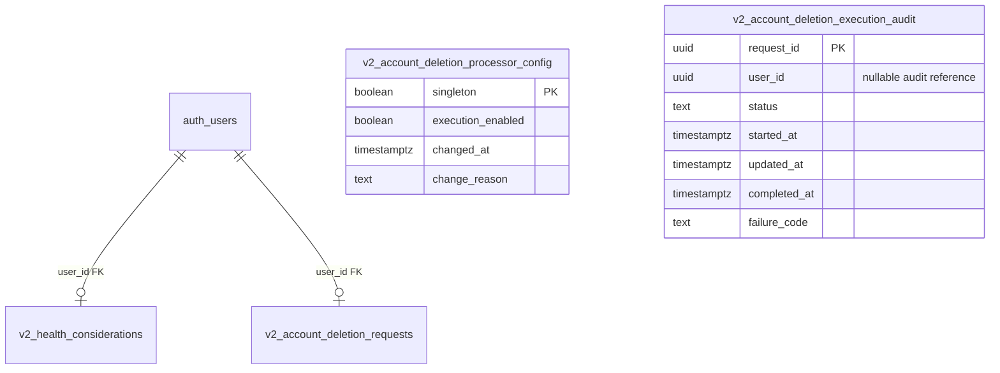

# ALL-222 — Live V2 security acceptance audit (2026-11-11)

**Status:** Evidence-backed read-only review; NOT universal schema approval, release authorization, migration or production test.
**Database:** V2 Supabase project `xarhuczrtzuiljmtdaeu`.
**Repository authority:** `allinproject/All-In-V2`, `integration/v2-foundation`.
**Scope:** Actual deployed foundation, private operational tables, exposed V2 RPCs and outstanding domain candidates.

## Database inventory and drift

Read-only Supabase inventory and `supabase_migrations.schema_migrations` equivalent API checks on November 11 found **18 applied V2 migrations**, including seven earlier foundation/cache migrations and eleven newer private health/account-deletion/export/token-guard migrations. There are **12 V2-owned application tables**: 5 public and 7 `allin_private`. The existing eight-table foundation ERD is a correct historical slice but is **not the entire current physical schema**.

| Exposed public table | RLS | Policies | anon SELECT | authenticated SELECT | authenticated direct INSERT/UPDATE/DELETE |
|---|---|---:|---|---|---|
| `v2_profiles` | on | 2 | no | yes | no |
| `v2_profile_settings` | on | 1 | no | yes | no |
| `v2_onboarding_progress` | on | 1 | no | yes | no |
| `v2_legal_documents` | on | 1 | yes | yes | no |
| `v2_legal_acceptances` | on | 1 | no | yes | no |

Seven `allin_private` tables all have RLS ON, **zero policies**, and no direct SELECT/INSERT/UPDATE/DELETE grants to `authenticated`; neither `anon` nor `service_role` has direct table SELECT. This is intentional default-deny defense in depth **subject to the exact privileged RPC implementation**. Tables: `v2_profile_settings_actions`, `v2_provider_cache`, `v2_onboarding_actions`, `v2_health_considerations`, `v2_account_deletion_requests`, `v2_account_deletion_processor_config`, `v2_account_deletion_execution_audit`. Do not add permissive policies solely to clear adviser INFO findings.

**Not deployed:** Billing purchase/verified-event/attempt ledger, Training, Completed Activity and Community candidates. Existing read-only candidate SQL is NOT part of migration history. No live native/web billing endpoints or activated payment flags were verified by this audit.

## Physical extension of the eight-table foundation — newly deployed private tables

The original foundation ERD predates these four private aggregates. Current
database catalog/foreign-key inspection confirmed the following. These tables
are **already deployed** (not part of a new proposed migration).

| Private table | PK | Key physical fields and checks | FK |
|---|---|---|---|
| `v2_health_considerations` | `user_id uuid` | `conditions jsonb` and `limitations jsonb` each constrained to arrays; `coach_opt_in boolean DEFAULT false`; `version bigint >= 1`; `updated_at timestamptz` | `user_id → auth.users.id` |
| `v2_account_deletion_requests` | `user_id uuid` | Unique `request_id uuid`; `status` in requested/processing/completed/rejected/cancelled; `requested_at`, `updated_at`, nullable `resolved_at` | `user_id → auth.users.id` |
| `v2_account_deletion_processor_config` | `singleton boolean CHECK singleton` | `execution_enabled boolean DEFAULT false`; `changed_at`; `change_reason` | none |
| `v2_account_deletion_execution_audit` | `request_id uuid` | `user_id uuid nullable` (not an FK, preserves minimal audit after deletion); `status` in processing/failed/completed; timestamps; failure code constrained to auth_delete_failed/auth_verify_failed/completion_failed | none |

This physical extension is an inventory of observed table contracts, **not** a
claim that the account deletion processor has been turned on or end-to-end
deletion has been signed off. Existing worker/default-OFF constraints remain.

## Live V2 function privilege and owner-review matrix

Read-only `pg_proc`, `pg_namespace`, `has_function_privilege`, `pg_get_functiondef` inspection found:

- **10 signed-in callable SECURITY DEFINER functions:** `v2_accept_legal_documents`, `v2_cancel_account_deletion_request`, `v2_export_my_account_snapshot`, `v2_my_account_deletion_request`, `v2_my_health_considerations`, `v2_my_profile_state`, `v2_patch_profile_settings_section`, `v2_request_account_deletion`, `v2_save_health_considerations`, `v2_set_onboarding_step`.
- For all 10: `anon EXECUTE=false`, `authenticated EXECUTE=true`, `service_role EXECUTE=false`; owner `postgres`; function-level pinned empty `search_path`. Every definition contains `auth.uid()` and an `auth.users` check; 9 have an explicit expected-owner argument. `v2_my_profile_state()` gets its owner from `auth.uid()` without such an argument.
- 7 role-restricted server/maintenance functions have `service_role EXECUTE=true` and deny `anon`/`authenticated`: provider-cache get/put/prune and deletion claim/completion/failure/verification (**7** distinct functions total; verify the full exact procedure list in `pg_proc` before new migrations). The internal `allin_private.v2_provider_cache_prune_expired` is not executable by any API role.
- Function existence, grants and the presence of text in stored definitions do **not** prove complete authentication/session/cross-user correctness. Re-run documented two-user, stale-token, cancellation, export-data minimization and deletion worker boundary replays after any semantic change.

## Security advisor disposition

Supabase Security Advisor reported **7 INFO** `rls_enabled_no_policy` notices for the private no-grant tables listed above and **10 WARN** `authenticated_security_definer_function_executable` notices for the ten intentional owner-scoped application RPCs. The warnings are not automatically exploitable; neither are they independently proven safe just because an expected-actor check appears in the function text. Track and verify exact owner predicates, ACLs, no generic dynamic SQL, pinned `search_path`, valid current identity and stale/deleted-user handling. Review any new warning, function overload or privilege drift.

## Required acceptance before ALL-222 may be called complete

1. **Founder/domain-owner approval:** Explicitly accept the current domain ownership matrix, aggregate identity/retention rules, migration conventions, physical ERD proposal choices, Coach Apply boundary and cross-domain Training→Completed Activity handoff. Review the separately recorded open decisions. Document any narrower per-domain acceptance.
2. **Physical schema:** Each planned domain must have approved tables/columns/FKs/checks, event/revision uniqueness, retention and deletion semantics and documented RPC/Edge caller permissions before DDL. Do not label proposed schema deployed. The foundation inventory should be refreshed to include private health and deletion/export schema.
3. **Security run:** For each deployed or approved next slice, automated negative-role tests using actual `anon`/`authenticated` roles and two owners, stale/replayed actions, cross-owner reads/writes, races and cancellation/deletion. Verify `PUBLIC` EXECUTE revocations and exact `service_role` positive grants in production-equivalent installation; replay fixture role escalation alone is insufficient evidence. `SECURITY INVOKER` functions with an empty `search_path` still require explicit object grants; do not authorize application service RPCs merely by granting all direct private-table writes.
4. **Billing release gate:** `docs/architecture/sql/V2-SUBSCRIPTION-VERIFIED-LEDGER-CANDIDATE.sql` is still REVIEW-ONLY. It revokes client role access and uses service-role invoker RPCs, but **production execute grants and private object ownership privileges must be explicitly approved and checked** before a migration. Never deploy or arm payment endpoints from this document.
5. **Other pending domains:** Training/Completed Activity identity/outbox, Community privacy/moderation/visibility, Coach read/apply permissions, Ingredient/Recipe owner sourcing, and account export/deletion must each supply their own exact migration/grant/negative-role acceptance. Do not unblock every dependent issue because one candidate is isolated-PG green.
6. **Reproducibility:** Verify generated public TS types match deployed schema; clean lockfile install, typecheck, focused SQL replays and accepted Expo device build. Source-only smoke is not device acceptance.

**Decision:** Foundation privilege inventory is reviewed as of November 11; no unauthorized broad table grant was found in the queried role/table set. **ALL-222 remains In Progress** pending owner acceptance, per-domain physical decisions and release-specific role/device evidence. All production schema/payment flags unchanged by this audit.
