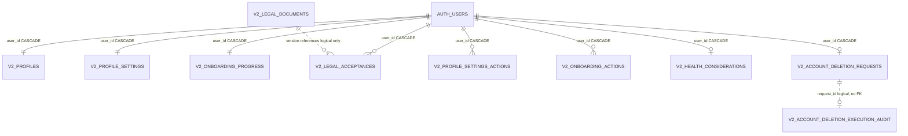

# ALL IN 365 V2 — Physical ERD and deployment-status matrix

**Read-only catalog checkpoint:** 2026-11-13, Supabase project `xarhuczrtzuiljmtdaeu` (canonical V2). **Status:** verified schema/grants/policies, **not** full HTTP or device acceptance. Source of truth for physical deployment is the live database catalog and applied migration ledger; review-only source files are not deployment evidence.

## 2026-11-13 verified staging-to-mobile contract handoff

**Authoritative two-environment catalog refresh, 2026-11-13:** Canonical project `xarhuczrtzuiljmtdaeu` has **5 public + 7 private = 12** V2 application tables; temporary staging `fbtgknlxjyeqrxemskbl` has **35 public + 20 private = 55** V2 application tables. **RLS is enabled on every counted V2 table in both projects**. Both currently have **zero published legal-document versions** and **zero Auth users**. This supersedes older dated table inventories in this document, not the historical evidence below. Staging is an isolated test target, **not** permission to copy or deploy its experimental domains to canonical V2.

**Real HTTP acceptance is now evidenced:** Protected GitHub Actions [run 43474309847 / job 132055665104](https://github.com/allinproject/All-In-V2/actions/runs/43474309847/job/132055665104) completed **SUCCESS** at the actual tested commit. The log proves genuine A/B GoTrue JWT sign-in; Profile, Onboarding, Training start/day readback, Settings and Health owner writes/reads; cross-account, anonymous and stale-screen denial; B's revoked bearer denied by Profile **and** Training readers; Food Log add/edit/move/delete, idempotency and competing-revision 200/409; guarded Storage upload denial; and cleanup of both synthetic Auth identities, with admin GET 404. Independent post-run staging readback showed **zero** test users/sessions, Training rows, Food Log entries and test-named Storage objects; deletion worker OFF. **Do not mistake this for a successful canonical-project HTTP test or installed iPhone test.**

### Mobile/backend contract readiness — no duplicate stores

| UI surface / owner | Canonical V2 physical availability | Staging availability / acceptance | Approved safe UI action |
|---|---|---|---|
| Authentication, Profile and six-step Onboarding — ALL-209/216 | Present: `v2_my_profile_state`, expected-owner `v2_patch_profile_settings_section`, `v2_set_onboarding_step` | Real A/B own/cross-owner and logout reader checks **passed** | Reuse existing `AuthProvider`, access gate, Profile/Onboarding clients; keep session-generation fencing and login-account cache clearing; device acceptance still pending |
| Legal acceptance — ALL-209/219 | Writer physically present; **0 published legal versions** | Writer guarded; invalid/unpublished versions fail closed | Show legal missing/unavailable state; **never open signup, fabricate legal versions or silently skip acknowledgements** |
| Private Health preferences/Coach consent — ALL-251/210 | Read/write RPCs present, private owner storage | Real A/B read/write and denial **passed**, Coach opt-in false by default | Wire through canonical existing Profile/consent owner; do not expose private table or infer consent |
| Training / active workout — ALL-222/243/246 | **Not deployed** in canonical V2 | Review-candidate session/day RPCs have passed real A/B test, with strict live-session fence | Staging-only experimental client adapter behind explicit project/env guard; never silently call from canonical or claim production workout support |
| Food Log — ALL-247 | **Not deployed** in canonical V2 | Add/read/mutate owner RPCs passed real A/B and race tests | Staging-only test adapter; hide or mark unavailable when canonical owner endpoint absent; do not build another Food Log ledger |
| Coach conversation, Ingredient/Cookbook, Completed Activity, Indoor, Storage review scaffolding | Not deployed as the relevant V2 domain tables in canonical | Physical candidate tables exist for some domains; source/test maturity varies | Preserve each owning issue's status and release packet; availability in temporary staging is **not** release approval |
| Data export — ALL-251 | `v2_export_my_account_snapshot` present but **intentionally incomplete/fail closed** | Same fail-closed contract verified; protected full download disabled | Do not label snapshot as complete portable account archive or expose enabled Export |
| Account deletion — ALL-251 | Request/status/cancel authenticated RPCs physically granted, but release policy/workflow not fully accepted | Three matching signatures deliberately **not executable by authenticated role**, verified deny | Keep destructive entry point unavailable; **never add staging grants to satisfy a positive test**; worker remains OFF |
| Community/Recovery/Progress/Billing/device integration | Review/design or source-only relative to canonical project | Not covered by this A/B RPC acceptance | Build UI against owning typed interface/fallback states only, no fabricated backend acceptance |

**UI integration contract:** Preserve the existing five root tabs (Today, Fuel, Train, Community, Coach), Profile via header/avatar; enforce exact project identity, signed-in owner, session generation and athlete-local date on every adapter. Display honest unavailable/empty/error states. An unavailable canonical RPC must *not* silently fall back to staging or a shadow V1 data store. Any production promotion requires a versioned migration, reviewed RLS/grants, owner-domain acceptance, all relevant release gates and actual installed-device checks. The successful 2026-11-13 A/B staging test does not close ALL-222 as a whole.

## Actual deployed physical ERD

**Legend:** Solid edge = verified physical foreign key. Dotted edge = logical relationship **not physically FK-enforced**. `auth.users` is the existing Supabase-managed Auth authority. Eight owner-based FK constraints reference `auth.users(id)` with `ON DELETE CASCADE`. `allin_private.v2_account_deletion_execution_audit` intentionally has no Auth FK to preserve minimal execution evidence, subject to retention approval; `v2_provider_cache` and `v2_account_deletion_processor_config` have no owner key. `v2_legal_documents` uses composite `(document_key,version)` key, while legal acceptance stores terms/privacy/founder-beta versions as strings validated by the writer, without direct foreign-key enforcement.

## Exact deployed table/RLS/access map

| Schema / table | Owner key | Authenticated/anon direct privileges | RLS/policy | Writer / lifecycle |
|---|---|---|---|---|
| public.v2_profiles | user_id → auth.users | authenticated SELECT, UPDATE **columns only** display_name/avatar_path; anon none | owner SELECT; UPDATE USING + WITH CHECK owner | Auth insert bootstrap; restricted profile edits |
| public.v2_profile_settings | user_id → auth.users | authenticated SELECT | owner SELECT | v2_patch_profile_settings_section, owner/CAS/action ID |
| public.v2_onboarding_progress | user_id → auth.users | authenticated SELECT | owner SELECT | v2_set_onboarding_step, owner/CAS/action ID |
| public.v2_legal_documents | product (document_key,version) | anon/authenticated SELECT | only published and effective | privileged review/publication, published content immutable |
| public.v2_legal_acceptances | user_id → auth.users | authenticated SELECT | owner SELECT | v2_accept_legal_documents |
| allin_private.v2_profile_settings_actions | user_id → auth.users | none for anon/authenticated/service_role | RLS ON, no policy | settings writer idempotency |
| allin_private.v2_onboarding_actions | user_id → auth.users | none | RLS ON, no policy | onboarding writer idempotency |
| allin_private.v2_provider_cache | no user key | none | RLS ON, no policy | trusted provider-cache RPC |
| allin_private.v2_health_considerations | user_id → auth.users | none | RLS ON, no policy | v2_my_health_considerations / v2_save_health_considerations |
| allin_private.v2_account_deletion_requests | user_id → auth.users | none | RLS ON, no policy | owner request/cancel; processing gated OFF |
| allin_private.v2_account_deletion_processor_config | singleton | none | RLS ON, no policy | privileged release gate, OFF |
| allin_private.v2_account_deletion_execution_audit | nullable user_id, no Auth FK | none | RLS ON, no policy | minimal privileged completion/failure evidence; retention not approved |

All 12 tables are postgres-owned and RLS-enabled. This is the **canonical V2 project's 18-applied-migration catalog**, not the temporary staging or isolated local schema. Foreign keys to Auth are identified above; do not infer a physical FK from dotted ERD edges or a field named `user_id`.

## Deployed public RPC surface (exact arg contracts)

**Authenticated-only SECURITY DEFINER (10; Supabase advisor WARN; verify function logic and live-role calls before closure):**

1. `v2_accept_legal_documents(expected_user_id UUID, terms_version TEXT, privacy_version TEXT, founder_beta_terms_version TEXT, age_18_confirmed BOOL, client_action_id TEXT)`
2. `v2_cancel_account_deletion_request(expected_user_id UUID, expected_request_id UUID)`
3. `v2_export_my_account_snapshot(expected_user_id UUID)` — **fail-closed incomplete export**, not full-domain encrypted archive
4. `v2_my_account_deletion_request(expected_user_id UUID)`
5. `v2_my_health_considerations(expected_user_id UUID)`
6. `v2_my_profile_state()` — derives owner from `auth.uid()`
7. `v2_patch_profile_settings_section(expected_user_id UUID, section TEXT, patch JSONB, expected_version BIGINT, client_action_id TEXT)`
8. `v2_request_account_deletion(expected_user_id UUID, confirm TEXT)`
9. `v2_save_health_considerations(expected_user_id UUID, conditions JSONB, limitations JSONB, coach_opt_in BOOL, expected_version BIGINT)`
10. `v2_set_onboarding_step(expected_user_id UUID, step TEXT, action TEXT, expected_version BIGINT, client_action_id TEXT)`

The actual PostgREST parameters have `p_` prefixes. All ten use `SECURITY DEFINER`, are owned by postgres, have `search_path=''`, and are executable by authenticated role; the function bodies reference `auth.uid()`. This catalog/body review alone does not certify denial behavior.

**Service-role-only public RPCs:** `v2_provider_cache_get`, `v2_provider_cache_put`, `v2_provider_cache_prune_expired`, `v2_claim_account_deletion_for_processing`, `v2_record_account_deletion_completion`, `v2_record_account_deletion_failure`, `v2_verify_account_deletion_completion`. Other functions are internal triggers/cron helpers and not client-executable. Do not infer independent credential custody from service_role grants.

## Implemented vs proposed domain matrix

| Domain | Canonical design owner | Physical canonical project state |
|---|---|---|
| Auth / Profile / Settings / Onboarding / Legal | ALL-216 | **DEPLOYED:** baseline tables/RPCs above; live session/device acceptance pending |
| Health considerations/Coach consent | ALL-251/Coach | **DEPLOYED:** private health store and owner RPC; Coach integration still separate |
| Account deletion intake/audit | ALL-251 | **DEPLOYED, EXECUTION OFF**; worker/Storage/recovery not accepted |
| Coach thread/context/proposals | ALL-210/222 | **REVIEW/SOURCE-ONLY** (no corresponding V2 physical tables here) |
| Ingredient Database / Cookbook | ALL-228/225/218 | **REVIEW/SOURCE-ONLY** |
| Training / plans / active sessions | ALL-246/222 | **REVIEW/SOURCE-ONLY** |
| Completed Activity / metrics | ALL-243/222 | **REVIEW/SOURCE-ONLY** |
| Fuel / Nutrition / Pantry / Kitchen | ALL-247/248 | **REVIEW/SOURCE-ONLY** |
| Progress / races / recovery / equipment | ALL-249/239/238/251 | **REVIEW/SOURCE-ONLY** |
| Community / EventHub / media | ALL-244 | **REVIEW/SOURCE-ONLY** |
| Watch / device ingestion / integration | ALL-245/243 | **REVIEW/SOURCE-ONLY** |
| Billing / entitlements / referrals | ALL-252/266 | **REVIEW-ONLY**; PR #5 not approved for merge or deployment |
| Complete-account encrypted export and private Storage | ALL-251 | **REVIEW/STAGING-ONLY**; incomplete account snapshot RPC is not release export; privileged route bypass remains open |

This deployment matrix does not invalidate later domain source implementations or test evidence, and does not authorize their DDL. Verify each against its owner-approved release packet before promotion.

## Historical SQL rehearsal (superseded by hosted A/B evidence above)

A rollback-only synthetic Auth A/B SQL smoke test on the canonical database succeeded: under `SET LOCAL ROLE authenticated` with simulated JWT subject B, `v2_my_profile_state()` returned B's owner identity, and `v2_my_health_considerations(expected=A)` raised authorization denial. **The expanded nine-owner-argument RPC matrix was blocked before execution, not passed**. `SET LOCAL ROLE` and `request.jwt.claim.sub` simulate an authenticated database context; they are not actual signed JWT, PostgREST, mobile session restoration or independently issued authentication. Do not mark all ten validated until each has A own success, B→A denial, A→B denial, anon denial, and post-switch stale-owner denial, plus invariant/readback and cleanup in isolated/staging and hosted HTTP.

## Remaining architecture acceptance

- Full body/security-definer role/function-call review and 10-RPC real-role, JWT/HTTP, stale-session and two-account matrix, including deliberately unavailable legal publication and incomplete export.
- Versioned physical DDL/owner FKs/grants/policies and tenant isolation for **each** review-only domain, independently staged before migration approval.
- Reproducible migration replay, generated types, profile/Coach/Today integration and installed-device acceptance.
- Explicit owner decision for legal document-version FK policy and deletion audit retention.
- ALL-251 privileged Storage HTTP REST/S3/signed/TUS delayed completion fence; no `uploadBarrierEnforced=true` or worker activation without provider-level proof; recovery, hosted KMS and legal acceptance separate.
